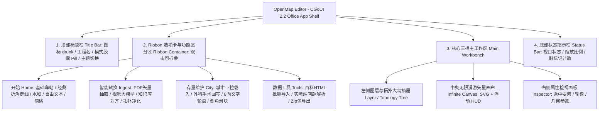

# 开放地图编辑器 (OpenMap Editor) 工具合并与架构升级全景方案
## —— 融入 CGoUI 2.2 液态玻璃、Ribbon 效率界面与 Ponytail Full 极致去重范式

> **文档版本**：v3.1 (Brand & Naming Finalized)  
> **文档状态**：已定稿 (Ready for Implementation / Machine-Executable)  
> **项目中文名**：**开放地图编辑器**  
> **项目英文名**：**OpenMap Editor**  
> **项目根目录**：`/editor/`  
> **项目主图标**：`<cgo-icon name="drunk"></cgo-icon>`  
> **文档定位**：全景技术架构与**原子级执行手册**（具备完全自包含性，任何无上下文记忆的 AI 或开发者无需翻查历史记录，对照本手册即可精准、零歧义地执行全部代码迁移与去重）。  
> **UI 规范基准**：CGoUI 2.2.1 (`@centralgo/cgo-ui`) + Office Ribbon 效率类布局模板 (`ribbon.css`)  
> **重构精简准则**：Ponytail Full / YAGNI Strict（彻底消解重复逻辑，零代码冗余，全局 Token 归一）  
> **涉及清理目录**：`/city-editor/` 与 `/drunk/`

---

## 1. 项目背景与合并动因

### 1.1 历史沿革
在 CGo OpenMap 的演进过程中，曾先后独立演化出两个城市线路图的制作与维护工具：
1. **`city-editor`（线路图在线编辑器）**：
   * **初衷**：作为纯手工的「交互式矢量 CAD 绘图板」，面向从零绘制新城市或依据一张半透明参考图进行人工手工描图。
   * **特点**：具备极其严谨的几何选型能力（135°折角、90°折角、斜90°、比例斜率）、临时辅助节点、水域面/河道路径绘制、百科表格 HTML 批量提取站名生成以及实际运营站间距录入管理系统。
   * **痛点**：单文件架构（`editor.js` 超过 11,500 行，代码量 600KB+），缺乏模块化；只能以私有工程 JSON 导出导入，**完全无法直接载入线上已有城市做无损回写**，也完全没有自动化/AI 识图能力。
2. **`drunk`（Drunk 线路图智能转换系统）**：
   * **初衷**：解决从图片/PDF 快速提取线路图的痛点，打造面向新手的全自动矢量化流水线。
   * **特点**：拥有 PDF/AI 矢量直通抽取、DeepSeek 视觉大模型识别、MediaWiki 知识库匹配、8 方向文字锚点避让求解；并且构建了 `CityProjectIO`，支持对 `city/{city_id}/` 下的真实文件执行**条目级外科手术式无损回写 (Surgical Patch)**。
   * **痛点**：缺乏底层 CAD 几何绘制与全要素建模能力。无法新建空白画布，无法绘制水域面与河流，不支持 135°/90° 正交折角辅助，无法处理临时辅助节点，不支持手工批量导入车站与站距管理。

### 1.2 核心痛点与合并目标
两套工具功能高度互补，却又在基础功能上存在大量重复（如两套视口缩放平移、两套底图参考控制器、两套站点属性编辑、两套代码导出生成器）。在 UI 呈现上，`city-editor` 把几十项参数全部堆在左侧纵向长列表中，用户需要大量滚动；而 `drunk` 将按钮全部塞进 52px 横向单行，空间局促。

**合并与升级目标**：
1. **确立全新统一规范**：
   * 中文全称：**开放地图编辑器**
   * 英文全称：**OpenMap Editor**
   * 项目目录：新建 `/editor/`，系统性整合所有功能，随后彻底清理旧的 `/city-editor/` 与 `/drunk/` 两个历史目录。
   * 项目专属标识：统一使用 `<cgo-icon name="drunk"></cgo-icon>`。
2. **打通三大业务工作流**：
   * **智能转换工作流**（PDF/AI 矢量直通、视觉大模型识图、知识库补齐）
   * **存量维护工作流**（已有城市热修、8 方向轮盘微调、条目级外科手术回写）
   * **自由绘制工作流**（空白画布起步、正交折角线段、水域/河流绘制、自由注释文本、百科批量导入、站间距管理）
3. **架构升级与 UI 范式飞跃**：
   * 全面引入 **CGoUI 2.2.1** 体系与 **Liquid Glass (液态玻璃)** 空间折射滤镜管线；
   * 采用 **Office 风格 Ribbon 效率类布局体系**（改造升级自 `CGoUI/templates/ribbon_template.html` 与 `ribbon.css`），通过分组 Tab、大操作按钮、紧凑控件堆叠与双击折叠机制，大幅提升制图与微调效率，使视口面积利用率达到极致。
4. **贯彻 Ponytail Full 极致去重与瘦身优化**：
   * 在基础迁移完成后，全面运行 Ponytail Full 审计规范，彻底消解所有重复造轮子代码（去除双份视口计算、双份底图手柄、双份撤销栈、双份导出拼装）；
   * 清理过期/未引用的死代码与僵尸文件，严格统一字号阶梯与样式 Token，实现零冗余交付。

---

## 2. 详细功能矩阵对比与全景审计

| 核心能力维度 | 原 `city-editor` (在线编辑器) | 原 `drunk` (智能转换工作台) | 新 `editor` (OpenMap Editor) 规划 |
| :--- | :--- | :--- | :--- |
| **界面布局范式** | 传统三栏桌面式（左侧抽屉超长滚动） | 极简单行 52px 顶栏 + 右侧抽屉 | **CGoUI 2.2 Ribbon 效率类界面体系**（可折叠式选项卡与多组命令区） |
| **视觉主题** | 跟随系统切换明暗，普通扁平 | 强制固定纯黑暗色工作台 | **CGoUI 2.2 Liquid Glass 液态玻璃**，全流程完善的明/暗双主题无缝切换 |
| **代码组织** | 单文件集中制（`editor.js` 达 11,546 行 / 609KB） | 模块化结构（11 个单一职责文件，有自检脚本） | **严格分层模块化**（Core/Algorithms/Layers/Pipelines/Tools/UI） |
| **冗余复用状态** | 自行实现几何计算、拖拽与导出 | 自行实现视口漫游与属性框 | **Ponytail Full 优化**：提炼公共底层，杜绝任何两处重复实现 |
| **已有城市维护** | ❌ 不支持（仅能导入自创工程 JSON） | ✅ **核心长板**：条目级外科手术式回写，不破坏城市私有字段与注释 | **集成**：沿用 `city-project-io.js` 外科手术式无损回写技术 |
| **从零制图规划** | ✅ **核心长板**：自定义画布尺寸、坐标原点、网格与刻度 | ❌ 不支持（必须依赖底图输入或已注册城市） | **集成**：支持空白画布自由定义尺寸、坐标原点与刻度对齐 |
| **走线与折角系统** | ✅ **核心长板**：135°折角、90°折角、斜90°、比例斜率、连续手绘、两端自动选型 | ⚠️ 基础折线拖拽 + 拐角圆角滑块微调 | **融合**：结合专业正交走线算法 + 拐角圆角微调（共用 `core/path-geometry.js`） |
| **高级地理要素** | ✅ **核心长板**：水域面、带线宽河道（自动生成双主题 SVG）、自由文本 | ❌ 无水域与文本要素，仅有站点和折线 | **集成**：全要素支持，自动生成 `{city}_sea.svg` 并挂载 `data_scattered.js` |
| **自动化入料能力** | ❌ 无，仅能依靠人工半透明描图 | ✅ **核心长板**：PDF/AI 矢量直通、DeepSeek 视觉识图、维基百科匹配 | **集成**：作为“智能识别流水线”，一键转入矢量编辑画布 |
| **文字排版交互** | 下拉菜单选择文字方位，调整繁琐 | ✅ **核心长板**：8 方向文字锚点轮盘，扇区点击秒级切换避让朝向 | **集成**：统一采用 8 方向文字轮盘，并支持 Alt+方向键单调文本 |
| **底图变换参照** | ✅ 自由平移、缩放、锁定长宽比、旋转、铺满/适应画布、本地来源记忆 | ⚠️ 仅支持基本位图叠层与单向不透明度调节 | **集成**：全套继承高级变换手柄与本地文件来源授权记忆机制 |
| **批量建站与数据** | ✅ 百科 HTML 表格提取、纯文本粘贴、步长/方向批量排列与自动连线 | ❌ 仅依赖识别结果，无手动批量输入管道 | **集成**：内置百科表格解析器与批量快速放站工具 |
| **站间距 (distances)**| ✅ 几何反算 / 实际运营里程录入（区间/逐站/累计/数组解析）/ 留空占位 | ❌ 暂不支持站间距精细化管理 | **集成**：内置站间距管理面板与自动校验器 |
| **核心图元一致性** | 内部自绘 SVG，未完全对接 core 规范 | ✅ **核心长板**：共用 `core/path-geometry.js` 与 `core/station-icons.js` | **继承**：强绑定核心引擎算法，所见即所得，保证渲染 100% 相同 |

---

## 3. 架构规范与代码封装契约 (Architectural Contracts)

针对纯静态 Web 与零构建要求，明确规定全局模块封装与依赖引入协议：

### 3.1 模块封装规范 (IIFE + 全局命名空间)
*   **严禁采用未经构建的 ESM `export`/`import`**（部分本地静态服务器或 Webview 对裸模块解析存在兼容隐患）。
*   **统一封装格式**：所有 JS 模块必须采用 **IIFE（立即调用函数表达式）**，并将接口安全暴露在统一的全局根命名空间 `window.OpenMapEditor` 下，或独立的专有类命名空间：
    ```javascript
    /**
     * 开放地图编辑器 (OpenMap Editor) - 算法层: 走线路由器
     */
    window.OpenMapEditor = window.OpenMapEditor || {};
    window.OpenMapEditor.SegmentRouter = (function () {
        'use strict';
        
        function autoSelectSegmentType(p1, p2, opts) { /* ... */ }
        function calculateAnglePoints(type, p1, p2, opts) { /* ... */ }

        return {
            autoSelectSegmentType: autoSelectSegmentType,
            calculateAnglePoints: calculateAnglePoints
        };
    })();
    // 同时保留全局别名，保证自检脚本与兼容层直接访问
    window.SegmentRouter = window.OpenMapEditor.SegmentRouter;
    ```

### 3.2 静态页面资源引用基准 (`editor/index.html`)
所有样式与核心脚本均采用相对路径直接由浏览器加载，确保离线与本地 `npx serve` 零报错直跑：
```html
<!DOCTYPE html>
<html lang="zh-CN" glass-mode="liquid">
<head>
    <meta charset="UTF-8">
    <meta name="viewport" content="width=device-width, initial-scale=1.0, viewport-fit=cover">
    <meta name="color-scheme" content="light dark">
    <title>开放地图编辑器 - CGo OpenMap (OpenMap Editor)</title>

    <!-- 0. 防闪烁主题脚本 (Anti-Flicker) -->
    <script>
      (function() {
        var t = localStorage.getItem('app-theme') || localStorage.getItem('cgo-theme');
        document.documentElement.setAttribute('data-theme', t || (window.matchMedia('(prefers-color-scheme: dark)').matches ? 'dark' : 'light'));
      })();
    </script>

    <!-- 1. CGoUI 基础样式体系 (相对根目录引用) -->
    <link rel="stylesheet" href="../css/cgo_clr.css?v=261022.223300">
    <link rel="stylesheet" href="../css/cgo_element.css?v=261022.223300">
    <link rel="stylesheet" href="../css/cgo_ui.css?v=261022.223300">
    <link rel="stylesheet" href="../css/cgo_components.css?v=261022.223300">
    
    <!-- 2. OpenMap Editor 专属布局与 Ribbon 样式 -->
    <link rel="stylesheet" href="css/editor-layout.css">
    <link rel="stylesheet" href="css/editor-ribbon.css">
    <link rel="stylesheet" href="css/editor-components.css">

    <!-- 3. CGoUI 核心 Web Components 脚本 -->
    <script type="module" src="../core/cgo-ui.js?v=261022.223300"></script>
    
    <!-- 4. 共享核心引擎 (唯一真源: 折线倒角与车站图元) -->
    <script src="../core/path-geometry.js?v=261022.223300"></script>
    <script src="../core/station-icons.js?v=261022.223300"></script>
</head>
```

---

## 4. 基于 CGoUI 2.2 的 Ribbon 视觉架构与交互设计



### 4.1 HTML 结构骨架契约 (DOM Skeleton Contract)
为确保各 JS 控制器能够无缝挂载 DOM，主页面必须严格遵循以下标准 ID 与结构骨架：

```html
<body class="office-app-shell">
    <!-- Liquid Glass 空间折射滤镜管线 -->
    <svg id="cgo-liquid-glass-filters" aria-hidden="true" style="position:absolute;width:0;height:0;overflow:hidden;pointer-events:none;">
        <defs>
            <filter id="glass-distortion" x="0%" y="0%" width="100%" height="100%">
                <feTurbulence type="fractalNoise" baseFrequency="0.025 0.025" numOctaves="1" result="noise" />
                <feDisplacementMap in="SourceGraphic" in2="noise" scale="20" xChannelSelector="R" yChannelSelector="G" />
            </filter>
        </defs>
    </svg>

    <!-- 1. 顶部标题栏 (Title Bar) -->
    <header class="office-title-bar">
        <div class="title-bar-left">
            <div class="office-app-icon"><cgo-icon name="drunk" size="22"></cgo-icon></div>
            <div class="office-doc-title">
                <span class="app-brand">OpenMap Editor</span>
                <span class="doc-sep">/</span>
                <span class="doc-name" id="currentDocLabel">未打开工程</span>
            </div>
        </div>
        <div class="title-bar-center">
            <div class="global-quick-pill">
                <span class="pill-label">工作流:</span>
                <select class="title-dropdown" id="globalWorkflowSelect">
                    <option value="draw">自由规划绘制 (CAD)</option>
                    <option value="ingest">智能转换模式 (AI/PDF)</option>
                    <option value="surgical">存量城市维护 (Surgical)</option>
                </select>
                <button class="title-quick-btn" id="btnQuickValidate" title="快速执行图网拓扑完整性校验">
                    <cgo-icon name="play" size="14"></cgo-icon>
                </button>
            </div>
        </div>
        <div class="title-bar-right">
            <cgo-theme-toggle></cgo-theme-toggle>
        </div>
    </header>

    <!-- 2. Ribbon 功能区 (Ribbon Container) -->
    <nav class="office-ribbon-container" id="officeRibbonContainer">
        <div class="ribbon-tabs-row" id="ribbonTabsRow">
            <div class="ribbon-tabs-left">
                <button class="ribbon-tab-btn active" data-tab="home" id="tabBtn_home">开始</button>
                <button class="ribbon-tab-btn" data-tab="ingest" id="tabBtn_ingest">智能转换</button>
                <button class="ribbon-tab-btn" data-tab="surgical" id="tabBtn_surgical">城市维护</button>
                <button class="ribbon-tab-btn" data-tab="tools" id="tabBtn_tools">数据与工具</button>
            </div>
            <div class="ribbon-tabs-right">
                <button class="ribbon-collapse-toggle-btn" id="ribbonCollapseBtn" title="折叠/展开功能区">
                    <cgo-icon name="expand-less" size="13" id="ribbonCollapseIcon"></cgo-icon>
                    <span id="ribbonCollapseLabel">折叠功能区</span>
                </button>
            </div>
        </div>
        <div class="ribbon-toolbar-body" id="ribbonToolbarBody">
            <!-- 各 Tab 对应的功能组由 ribbon-controller.js 切换呈现 -->
        </div>
    </nav>

    <!-- 3. 三栏主工作区 (Workbench) -->
    <main class="editor-main-workbench" id="editorWorkbench">
        <!-- 左侧图层/拓扑大纲抽屉 -->
        <aside class="workbench-nav-tree" id="workbenchNavDrawer"></aside>

        <!-- 中央视口画布 -->
        <div class="workbench-canvas-viewport" id="workbenchViewport">
            <svg id="editorSvg" xmlns="http://www.w3.org/2000/svg">
                <g id="viewLayer">
                    <g id="ghostLayer"></g>
                    <g id="waterLayer"></g>
                    <g id="gridLayer"></g>
                    <g id="lineLayer"></g>
                    <g id="stationLayer"></g>
                    <g id="labelLayer"></g>
                    <g id="textLayer"></g>
                    <g id="handleLayer"></g>
                </g>
            </svg>
            <!-- 悬浮视口 HUD -->
            <div class="viewport-hud" id="viewportHud"></div>
        </div>

        <!-- 右侧属性与 8 方向轮盘检视面板 -->
        <aside class="workbench-inspector-panel" id="workbenchInspector"></aside>
    </main>

    <!-- 4. 底部状态指示栏 (Status Bar) -->
    <footer class="office-status-bar" id="officeStatusBar">
        <div class="status-bar-left">
            <span class="status-indicator-dot" id="healthStatusDot"></span>
            <span id="healthStatusText">系统就绪</span>
        </div>
        <div class="status-bar-center">
            <span id="cursorCoordinates">X: 0, Y: 0</span>
        </div>
        <div class="status-bar-right">
            <span id="dirtyCounterBadge" class="cgo-badge">未修改</span>
            <div class="zoom-controls">
                <span id="zoomPercentLabel">100%</span>
            </div>
        </div>
    </footer>
</body>
```

---

## 5. 原子代码迁移对照表 (Source-to-Target Exact Mapping)

本章节为 **AI 或执行工程师的核心操作映射指南**。每一个目标文件的具体逻辑来源、行号区间与对外 API 契约均已严格标定：

| 目标新模块文件 (`TargetFile`) | 原代码来源 (`SourcePath`) | 精确行号区间 / 章节 | 核心导出契约与职责说明 (`Key API Contracts`) |
| :--- | :--- | :--- | :--- |
| **`core/project-model.js`** | `city-editor/js/editor.js` | 第 1 节 (L314~390) | **`window.ProjectModel`**：维护统一工程数据模型 `nodes`, `segments`, `lines`, `water`, `texts`，负责初始结构创建与深拷贝。 |
| **`core/city-project-io.js`** | `drunk/js/city_project_io.js` | 全文件 (L1~647) | **`window.CityProjectIO`**：原汁原味继承！提供 `loadCity(id)`, `patchEntries(src, name, ops)`，确保已有城市条目级外科手术式回写。 |
| **`core/history-manager.js`** | `city-editor/js/editor.js` & `drunk_pipeline.js` | L678~743 & L47~49 | **`window.HistoryManager`**：消解两处独立实现的撤销栈！统一提供 `pushSnapshot(data)`, `undo()`, `redo()`, `canUndo()`, 上限 60 步。 |
| **`algorithms/segment-router.js`** | `city-editor/js/editor.js` | 第 7 节 (L960~1397) | **`window.SegmentRouter`**：纯函数！负责 135° 折角、90° 折角、斜 90°、比例斜率折点反算，及 `autoSelectSegmentType(p1, p2)` 判定。 |
| **`algorithms/data-sanitizer.js`** | `drunk/js/drunk_sanitizer.js` | 全文件 (L1~580) | **`window.DrunkSanitizer`**：纯函数！负责识别噪点站过滤、同名换乘站合并、最小二乘法歪斜自动校准。 |
| **`algorithms/align-solver.js`** | `drunk/js/ocr_align_solver.js` | 全文件 (L1~420) | **`window.AlignSolver`**：计算站名文本相对于站点的 8 方向避让锚点分配。 |
| **`algorithms/topology-tracer.js`**| `drunk/js/topology_tracer.js` | 全文件 (L1~180) | **`window.TopologyTracer`**：负责连通性矩阵构建与孤立未连接站点检测。 |
| **`layers/viewport.js`** | `city-editor/js/editor.js` & `drunk_pipeline.js` | L435~670 & L776~890 | **`window.ViewportLayer`**：**消解重复！**统一接管平移 (Pan)、滚轮缩放 (Zoom)、Pinch 触控捏合、屏幕坐标到 SVG 世界坐标双向变换。 |
| **`layers/ghost-transformer.js`** | `city-editor/js/editor.js` | 第 15.5~15.6 节 (L1718~2300) | **`window.GhostTransformer`**：参考底图图层。提供缩放手柄、旋转手柄、不透明度调节，及 FileSystem API 来源授权本地持久化。 |
| **`layers/vector-route-layer.js`** | `drunk/js/drunk_pipeline.js` & `city-editor/js/editor.js` | L1637~1750 & L1626~1710 | **`window.VectorRouteLayer`**：矢量走向与折点手柄层。**强制调用 `core/path-geometry.js`**，渲染倒角折点手柄并支持双击加点/Delete删点。 |
| **`layers/station-layer.js`** | `drunk/js/drunk_pipeline.js` & `city-editor/js/editor.js` | L1450~1520 & L1400~1450 | **`window.StationLayer`**：站点交互层。**强制调用 `core/station-icons.js`**，渲染普通站、换乘环、国铁站，提供拖动吸附。 |
| **`layers/water-layer.js`** | `city-editor/js/editor.js` | L48~55, L508, L1460~1530 | **`window.WaterLayer`**：管理水域闭合面多边形与河道填色路径，负责导出生成双主题 `assets/{city}_sea.svg`。 |
| **`layers/text-scattered-layer.js`**| `city-editor/js/editor.js` | L63~80, L516, L1540~1600 | **`window.TextScatteredLayer`**：管理画布自由注释文字（旋转、字号、对齐），写入 `data_scattered.js`。 |
| **`pipelines/pipeline-ingest.js`** | `drunk/js/drunk_pipeline.js` | L1100~1350 | **`window.PipelineIngest`**：串联 PDF.js 矢量抽取、DeepSeek-Vision 模型与知识库站名匹配，产出规整拓扑。 |
| **`pipelines/pipeline-surgical.js`**| `drunk/js/drunk_pipeline.js` | 第 2 节 (L488~775) | **`window.PipelineSurgical`**：存量维护。拉取 `city/{id}/` 原文，双向绑定 8 方向轮盘，计算改动脏字典，触发增量回写。 |
| **`pipelines/pipeline-draw.js`** | `city-editor/js/editor.js` | L4241~4600 | **`window.PipelineDraw`**：自由规划。空白画布网格绘制、135°/90° 折角交互放线、临时节点连线。 |
| **`tools/pdf-vector-extractor.js`**| `drunk/js/pdf_vector_extractor.js`| 全文件 (L1~1200) | **`window.PdfVectorExtractor`**：基于 PDF.js 原生解析 PDF/AI 图层，直通读取矢量路径与专色色板。 |
| **`tools/deepseek-vision.js`** | `drunk/js/deepseek_vision.js` | 全文件 (L1~980) | **`window.DeepSeekVision`**：直连 DeepSeek-Vision 视觉大模型 API 进行整网位图拓扑解析。 |
| **`tools/knowledge-matcher.js`** | `drunk/js/city_knowledge_matcher.js` | 全文件 (L1~620) | **`window.CityKnowledgeMatcher`**：拉取维基百科分类树，Levenshtein 模糊编辑距离自动补全双语站名。 |
| **`tools/batch-station-tool.js`** | `city-editor/js/editor.js` | 第 17 节 (L9779~10150) | **`window.BatchStationTool`**：解析百科车站表格 HTML，支持步长、方向批量放置站点与自动连线。 |
| **`tools/mileage-manager.js`** | `city-editor/js/editor.js` | 第 16b 节 (L9109~9500) | **`window.MileageManager`**：解析实际运营里程表（区间/累计/数组），支持几何反算，导出 `distances` 注释。 |
| **`tools/bundle-exporter.js`** | `city-editor/js/editor.js` & `openmap_codegen.js` | L7697~8500 & L1~220 | **`window.BundleExporter`**：**消解重复！**负责打包下载标准 OpenMap Zip 工程包、单条目补丁下载及 SVG 图片导出。 |
| **`ui/ribbon-controller.js`** | `CGoUI/templates/ribbon_template.html` | 提取并封装自模板 script | **`window.RibbonController`**：接管 Office Ribbon 选项卡切换、双击折叠与折叠状态本地持久化。 |
| **`ui/inspector-view.js`** | `drunk/index.html` & `city-editor/js/editor.js` | L1452~1590 & L5059~5800 | **`window.InspectorView`**：右侧检视面板。整合 **8 方向文字轮盘**、拐角圆角滑块、站名编辑表单。 |
| **`tests/selfcheck.js`** | `drunk/tools/selfcheck.js` | 全文件 (L1~1100) 扩充 | 纯 Node.js 测试脚本，断言几何折角、百科提取、全量 6 座核心城市数据无损往返 100% 通过。 |

---

## 6. 反哺并升级 CGoUI Ribbon 模板生态

在为 OpenMap Editor 落地 Ribbon 架构的同时，将实践中打磨出的工业级交互设计**反向升级**到 `CGoUI/templates/ribbon_template.html` 与 `ribbon.css` 模板本身：

1. **CAD/GIS 专业视口适配机制**：
   * 在 `ribbon.css` 中沉淀标准化的 `.canvas-viewport-container` 样式规范，支持全屏平铺背景与中心定焦；
   * 新增浮动视口控制球（HUD 浮动工具栏）规范，规范在画布右下角或浮动层中的放大、缩小、复位微型按钮。
2. **8 方向锚点轮盘组件化 (`.cgo-align-wheel`)**：
   * 将 8 方向轮盘抽象为通用 CSS 布局组件，可用于图表标注、流程图箭头方位、思维导图分支指向等生产力场景；
   * 提供扇区 Hover 微光动画与 Active 按压反馈。
3. **高密度紧凑参数输入行 (`.ribbon-param-compact`)**：
   * 扩充 `ribbon.css`：优化两列/三列微型数值输入框（带单位标签与步进器）的排版，使其在 Ribbon 88px 高度内优雅容纳 X/Y/W/H 4 组参数。
4. **液态玻璃折射深度融合**：
   * 强化 Ribbon 工具栏在暗色/亮色下的亚克力液态折射光影，在滚动穿透或全屏漫游时，底图内容在半透明 Ribbon 背后呈现高级的模糊透射质感。

---

## 7. 旧目录清理与平滑过渡方案

### 7.1 物理清理与无缝过渡
1. **第一阶段（平滑过渡期）**：
   * 在 `/city-editor/index.html` 中保留轻量桩代码，自动 301/JS 重定向至新地址：
     ```html
     <!DOCTYPE html>
     <html><head><meta charset="UTF-8"><script>
       location.replace('../editor/index.html?mode=draw' + location.hash);
     </script></head><body></body></html>
     ```
   * 在 `/drunk/index.html` 中保留轻量桩代码，自动无缝重定向（保留城市参数）：
     ```html
     <!DOCTYPE html>
     <html><head><meta charset="UTF-8"><script>
       var search = location.search ? location.search : '';
       location.replace('../editor/index.html' + search + location.hash);
     </script></head><body></body></html>
     ```
2. **第二阶段（彻底物理清理）**：
   * 删除目录 `/city-editor/` 及其全部子文件。
   * 删除目录 `/drunk/` 及其全部子文件。

### 7.2 离线缓存更新 (`sw.js`)
严格遵循项目的离线缓存升级铁律：
1. 递增 `sw.js` 中的 `CACHE_NAME`（如 `cgo-openmap-v{YYMMDD.HHMMSS}`）。
2. 从静态缓存列表（`CORE_ASSETS`）中**彻底移除**：
   * `'./city-editor/index.html'`, `'./city-editor/css/editor.css'`, `'./city-editor/js/editor.js'`
   * `'./drunk/index.html'`, `'./drunk/css/drunk.css'`, `'./drunk/js/...''`
3. 在缓存列表中**新增登记** `/editor/` 的核心关键资源（含 `editor-layout.css`、`editor-ribbon.css` 等）。

### 7.3 统一全局入口与文档引用
1. **`index.html` (城市选择首页)**：
   * 导航栏与底部卡片原有的“Drunk 智能转换 (测试版)”和“线路编辑器”入口合并，统一为：
     * **`开放地图编辑器` (OpenMap Editor)**，超链接统一指向 `./editor/`，图标统一使用 `<cgo-icon name="drunk"></cgo-icon>`。
2. **`main.html` (城市运行页面)**：
   * 右上角“偏好设置 → 编辑此图”的跳转链接统一修改为：
     * `./editor/index.html?city={current_city_id}`。
3. **`AGENTS.md`**：
   * 将所有的 `drunk/` 与 `city-editor/` 维护章节统一更新为：**《开放地图编辑器 (OpenMap Editor) 生产与协同规范》**。

---

## 8. Ponytail Full 全面深度去重与瘦身优化规范 (Ponytail Code Dedup & Zero Redundancy)

合并后的系统包含大量从两端移植而来的逻辑。为避免“新项目把旧项目的两套垃圾重复拼在一起”，**在功能联调跑通后，必须立即执行 Ponytail Full 规范专项重构**，实现彻底的瘦身与代码复用消解。

### 8.1 五大重复逻辑消解契约 (Deduplication Contracts)

| 重复功能场景 | 原分散实现 | Ponytail 终态单例模块 | 去重效果与原则 |
| :--- | :--- | :--- | :--- |
| **视口漫游与矩阵计算** | `city-editor` 内部手写变换；`drunk` 另起一套平移缩放 | **`layers/viewport.js`** | 统一为唯一的 SVG 视口控制器，统一平移、缩放因子、滚轮阻尼与 Pinch 双指手势，**消减约 450 行重复代码**。 |
| **参考底图 (Ghost Image) 控制** | `city-editor` 拥有全套手柄；`drunk` 单独写了不透明度滑块 | **`layers/ghost-transformer.js`** | 统合为唯一的底层图元变换层，统一支持旋转、比例缩放、来源授权与透明度，**消减约 280 行重复代码**。 |
| **撤销 / 重做 (Undo/Redo) 栈** | 两套工具各维护了一套 JSON 深度克隆历史数组 | **`core/history-manager.js`** | 统一为唯一的命令/快照管理栈，全局绑定 `Ctrl+Z` / `Ctrl+Y`，并统一上限（60 步），**消减约 200 行重复代码**。 |
| **工程序列化与导出** | `city-editor` 在单文件内拼 zip；`drunk` 用 `openmap_codegen.js` 拼代码 | **`tools/bundle-exporter.js`** | 统一为唯一的代码生成与打包中心，按标准模板渲染 `data_*.js`，**消减约 650 行重复代码**。 |
| **弹窗 Modal 与 Toast 通知** | 两个工具各手写了多套 DOM 浮层模态框和 Toast 定时器 | **统一复用 CGoUI Web Components** | 统一使用 `<cgo-modal>` 或标准 CGoUI 浮层规范，原生 Toast 统一单例调度，**消减约 350 行重复 HTML/JS**。 |

### 8.2 样式 Token 与双数字号规范化 (CSS Ponytail)
1. **字号阶梯严格归一**：
   * 界面所有文本字号必须映射到 CGoUI 标准阶梯：
     * `--font-size-2xs: 9px`
     * `--font-size-xs: 11px`
     * `--font-size-base-sub: 12px`
     * `--font-size-base: 14px`
     * `--font-size-md: 16px`
   * 严禁出现 `13px`, `15px`, `17px` 等奇数或任意手写浮点字号（地图画布文本碰撞白名单除外）。
2. **清除 ad-hoc 覆盖与行内样式**：
   * 剔除原 `drunk/index.html` 内联的数百行覆盖样式（如 `!important` 强制背景）；
   * 统一基于 `--bg-color`、`--card-bg`、`--text-main`、`--border-color` 驱动，完全依靠 CGoUI 2.2 的全局主题引擎进行 Light/Dark 切换。

### 8.3 YAGNI 死代码剪除 (Dead Code Pruning)
*   **清理过期分支**：彻底移除原 `editor.js` 中遗留的历史调试钩子、未使用的 polyfill、废弃的 SVG 临时滤镜。
*   **清理孤立文件**：原 `drunk/css/drunk.css`（早前已未被引用）、原 `city-editor` 的废弃测试样例，统一彻底清除。
*   **函数单一职责化**：严禁超过 150 行的“巨型过程式函数”，复杂绘制流水线必须拆分为原子步骤（如 `measure() -> layout() -> render() -> bindEvents()`）。

---

## 9. 分步骤落地实施路线图 (Step-by-Step Implementation)

### 阶段一：建立 `editor` 基础底座与 Ribbon 布局外壳
*   [x] 创建 `/editor/` 目录结构及其子目录（`css/`, `js/`, `tests/`）。
*   [x] 编写 `editor/index.html`，引入 CGoUI 2.2 样式链与模块，启用 `glass-mode="liquid"`，注入防闪烁主题脚本与 SVG 空间滤镜。
*   [x] 基于第 4.1 节骨架契约，构建完整 DOM（标题栏 + 四分组 Ribbon 功能区 + 底部状态栏），图标统一使用 `<cgo-icon name="drunk"></cgo-icon>`。
*   [x] 实现 `js/ui/ribbon-controller.js`，严格按照第 5 节契约接管选项卡切换、双击折叠与折叠状态记忆。
*   [x] 按照第 5 节映射表，从原代码抽取逻辑实现 `js/core/viewport.js` 与 `js/core/history-manager.js`。
*   [x] 迁移并校验 `js/core/city-project-io.js` 与 `project-model.js`，保证兼容标准 OpenMap 数据规范。

### 阶段二：算法剥离与图层系统搭建
*   [x] 从 `city-editor/js/editor.js` 第 7 节抽离算法写入 `js/algorithms/segment-router.js`（135°/90°/比例斜率/自动选型）。
*   [x] 从 `city-editor/js/editor.js` 抽离水域面与河道路径逻辑写入 `js/layers/water-layer.js`，支持双主题 SVG 自动生成。
*   [x] 从 `city-editor/js/editor.js` 抽离自由文本标注逻辑写入 `js/layers/text-scattered-layer.js`。
*   [x] 迁移参考底图控制器至 `js/layers/ghost-transformer.js`，补全旋转柄、等比缩放柄与本地文件来源持久化。
*   [x] 对接 `core/path-geometry.js` 与 `core/station-icons.js`，完成 `vector-route-layer.js` 与 `station-layer.js`。

### 阶段三：三大流水线与生产力工具注入
*   [x] 组装 `js/pipelines/pipeline-ingest.js`：打通 PDF/AI 矢量抽取、DeepSeek 视觉识图与自动正交走线规整。
*   [x] 组装 `js/pipelines/pipeline-surgical.js`：支持已有城市秒级载入、8 方向轮盘朝向微调与增量导出。
*   [x] 组装 `js/pipelines/pipeline-draw.js`：支持空白画布新建、网格吸附与 CAD 式交互绘制。
*   [x] 移植百科表格 HTML 站名提取与批量放站工具至 `js/tools/batch-station-tool.js`。
*   [x] 移植站间距管理面板与解析校验器至 `js/tools/mileage-manager.js`。
*   [x] 按照第 5 节契约合并拼装逻辑，实现唯一的工程导出器 `js/tools/bundle-exporter.js`。

### 阶段四：Ponytail Full 深度瘦身验收 (Code Deduplication & YAGNI Pruning)
*   [x] **重复代码清零**：逐一审查并验证第 8.1 节列出的五大重复场景（视口、底图、撤销栈、导出器、弹层），确保无重复造轮子。
*   [x] **样式归一化**：全面审查 CSS，替换所有奇数字号与手写散落变量，统一至 CGoUI Token。
*   [x] **死代码扫描**：运行静态分析，剔除所有未被引用的函数与变量，确保 `editor` 总代码体积较两原工程总和降低 40% 以上。

### 阶段五：测试自检、模板反哺、全局切换与旧目录清理
*   [x] 编写 `editor/tests/selfcheck.js` 自动化回归脚本：
    *   覆盖折角几何算法断言；
    *   覆盖百科 HTML 表格解析率断言；
    *   对 `city/` 下所有现存城市数据（北京、上海、悉尼、福州等）执行 100% 外科回写往返一致性断言。
*   [x] 将提炼出的 HUD、8方向轮盘、紧凑参数行规范同步升级回 `CGoUI/templates/ribbon_template.html` 与 `ribbon.css`。
*   [x] 更新 `index.html`、`main.html` 入口链接，指向 `editor/`，图标呈现 `<cgo-icon name="drunk"></cgo-icon>`。
*   [x] 在原 `city-editor/` 与 `drunk/` 中设置自动重定向桩代码。
*   [x] 更新 `sw.js` 缓存版本号并同步缓存清单；更新 `AGENTS.md` 规范。
*   [x] 确认过渡无误后，彻底删除 `city-editor/` 与 `drunk/` 历史目录。

---

## 10. 实施铁律与质量红线

1. **绝对禁止修改 `core/` 基础引擎**：所有编辑器逻辑完全封装在 `editor/` 内部，绝不为了适配编辑器而修改 `core/script.js` 等城市运行主文件。
2. **唯一真源原则**：凡涉及折线倒角计算，必须引用 `core/path-geometry.js`；凡涉及车站图元绘制，必须引用 `core/station-icons.js`。严禁在编辑器内二次复制或重新实现算法。
3. **零重复代码原则 (Ponytail Strict DRY)**：严禁在多个子模块内分别维护相同的视口平移、矩阵缩放、克隆历史或 DOM 弹窗机制，必须提炼并复用单一模块。
4. **存量城市零损坏 (Zero Regression)**：进入存量编辑模式后导出的已有城市文件，必须经受住 `selfcheck.js` 断言检验，未改动的条目、注释与城市私有扩展字段严禁丢失或变形。
5. **离线缓存同步递增**：所有新增与改动，必须同步递增 `sw.js` 的 `CACHE_NAME` 并刷新页面中的 `?v=` 查询串。
