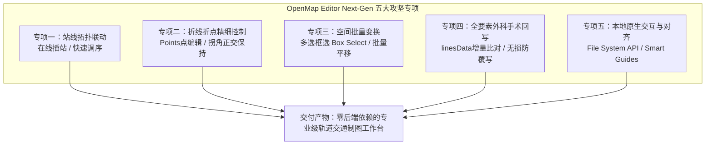

# 开放地图编辑器 (OpenMap Editor) 下一代体验与生产力升级方案
## —— 纯前端静态扁平化基石下的交互进化与全要素无损回写体系

> **文档版本**：v2.0 (Next-Gen Architecture Spec)  
> **文档定位**：团队协作升级与原子级执行手册（供项目组成员分工协同执行）  
> **适用模块**：`CGo-OpenMap/editor/` 及关联核心算法与回写层  
> **基石原则**：**坚守纯前端静态扁平化铁律，拒绝非必要立体化，聚焦二维矢量制图生产力极致**  
> **关联依据**：`CGo-OpenMap/AGENTS.md`（五大铁律）、`docs/OPENMAP_EDITOR_MERGE_PLAN.md`

---

## 一、 架构基石界定与设计哲学

在规划 OpenMap 编辑器的下一代升级前，必须首先在团队内部彻底统一步调与认知边界：

```text
┌────────────────────────────────────────────────────────────────────────┐
│                        架构定位与系统边界的本质区别                     │
├────────────────────────────────────────────────────────────────────────┤
│  CGo Map 2.0 (map2)                                                    │
│  ├─ 体系特征：全栈立体化、关系型数据库驱动 (PostgreSQL)                │
│  ├─ 复杂维度：L1城市 → L2站线 → L3归属 → L4几何 → L5运营交路/时刻表    │
│  └─ 微观业务：三层出入口通路(Pathways)、车厢编组立体月台(StationLayout) │
├────────────────────────────────────────────────────────────────────────┤
│  CGo OpenMap (openmap)                                                 │
│  ├─ 体系特征：纯前端绝对纯粹性 (Vanilla JS + SVG + CSS3)、零后端依赖   │
│  ├─ 数据模型：扁平化静态字典 (data_stations.js, data_lines.js 等)     │
│  └─ 核心使命：轻量、开源、极致丝滑、免运维托管、人人可读写参与          │
└────────────────────────────────────────────────────────────────────────┘
```

### 1.1 坚决不做的“非目标”（Anti-Goals）
1. **绝不引入后端服务与数据库**：严禁为了所谓的“保存便利”引入 Node.js/Python 守护进程或 SQLite/PostgreSQL 本地库，必须保持任何静态 Web 服务器均可即开即用的极简性。
2. **绝不强行将数据模型“立体化”**：
   * 不在 OpenMap 编辑器中堆砌发车时刻表（Timetable）排班系统；
   * 不引入车厢编号与微观立体站台结构（StationLayout）图元；
   * 不引入三层街区出入口网络拓扑。
   这些属于 Map 2.0 专属的重型调度调度业务，强行移植会彻底破坏 OpenMap 的扁平优雅。

### 1.2 下一代升级的核心战场
在**纯前端、扁平化静态架构的铁律底座**上，全面向专业级二维矢量 CAD 制图工具（如 Illustrator / AutoCAD）与现代 Web 交互工具（如 Figma）看齐，彻底解决 OpenMap 编辑器目前在**制图效率、站线拓扑联动、折点精准微调、全要素无损回写以及原生文件交互**上的 5 大硬伤。

---

## 二、 下一代升级五大核心专项 (Five Core Thrusts)



---

### 专项一：站线拓扑联动与可视化“在线插站/调序” (Station-Route Topology)

#### 1. 痛点剖析
当前编辑器中，放置车站（`S`）仅仅是在画布上生成一个独立的坐标点（`node`），车站与线路的拓扑逻辑完全脱节。检视面板（Inspector）无法调整该车站属于哪条线、在各线中的顺位是多少。在已有线路上添加新站时，必须手动修改数据或重新连线。

#### 2. 升级改造方案
1. **在线智能吸附插站（Click-to-Insert on Line）**：
   * 在「添加车站」工具激活状态下，当鼠标悬停在线路折线上时，线路高亮显示投影吸附点；
   * 点击线路时，系统执行拓扑计算：
     1. 计算点击位置处于该线路该区段的哪两个车站（$Sta_A$ 与 $Sta_B$）之间；
     2. 自动在画布创建新车站节点；
     3. 自动更新当前工程中该线路的 `stationIds`（或分支 `stationIds-way1`），在 $Sta_A$ 与 $Sta_B$ 之间插入新站 ID；
     4. 自动切分该折线线段，保持拓扑连贯。
2. **车站检视面板（Inspector）集成轻量「线路归属」模块**：
   * 选中任一车站时，Inspector 显示当前车站的归属线路列表 Tag；
   * 提供「加入线路 / 移出线路」快捷下拉框；
   * 提供「站序微调（上移一位 / 下移一位）」按钮，直接反映在 `linesData[i].stationIds` 序列中。
3. **拓扑防断连自愈**：
   * 删除某个车站时，弹出二次确认，并自动从引用该站的所有线路 `stationIds` 中平滑摘除，防止产生孤儿悬空 ID。

---

### 专项二：折线折点精细控制与自由点编辑模式 (Points & Corner Refinement)

#### 1. 痛点剖析
当前编辑器初次生成 135°/90° 折线体验良好，但**对存量折线的二次微调与拐点控制严重不足**：
* 拖动车站时，仅更新了带有 `nid` 的线段端点，线段中间纯坐标拐点不动，导致原本正交的 45°/90° 走向立刻发生斜率畸变；
* 无法在一条已有折线中间随时“插入一个拐点”进行局部微小绕行。

#### 2. 升级改造方案
1. **新增「点编辑模式（Points Mode，快捷键 P）」**：
   * 选中某条折线后激活此模式，折线上的所有顶点、拐角点和中点均呈现可交互 Handle；
   * **增删拐点**：
     * 在折线线段中点处显示半透明“添加手柄”，点击或双击即可原地增加一个折点；
     * 选中任一中间拐点，按 `Delete` / `Backspace` 即可移除该拐点，两端自动拉直。
2. **车站拖动时的正交角度联动保持（Orthogonal Preserving）**：
   * 改进 `editor-app.js` 拖拽逻辑：当拖动带有 `draggedNodeId` 的端点时，检测相连中间拐点的连线形态（垂直/水平/45°）；
   * 若此前为正交折角，中间拐点应自动沿正交导轨协同推移，而不是固定原地导致产生任意畸变夹角。
3. **拐角圆角半径微调（Corner Radius）**：
   * 在 Inspector 的线段属性中，增加拐角半径选项：
     * `r: 0`（严格直角）
     * `r: 8`（紧凑小圆角）
     * `r: 18`（标准大圆角）
     * 自由数值滑块（支持非标特殊拐角）。

---

### 专项三：多选框选与空间批量平移 (Box Selection & Batch Spatial Transformation)

#### 1. 痛点剖析
当前编辑器仅支持单选。在维护成熟大网时，核心区新增交路往往需要将周围数个街区的十余座车站及多条折线向外平移 50~100px 腾出排版空间。单点逐一拖动耗时极长且容易破坏既有相对几何关系。

#### 2. 升级改造方案
1. **视口框选工具（Box Selection，快捷键 B）**：
   * 在视口空白区域按住鼠标左键拖拽，拉出半透明矩形选框；
   * 实时计算与选框相交的图元集合：车站节点（`nodes`）、自由注释（`texts`）、地标散点（`scattered`）以及线段控制点；
   * 选中的所有图元渲染统一的群组外接虚线轮廓包围盒（Bounding Box）。
2. **群组整体平移与微调**：
   * 拖拽选框内的任一图元，所有被选图元同步应用 $(\Delta x, \Delta y)$ 位移；
   * 键盘方向键支持步进平移（普通方向键 1px，`Shift + 方向键` 10px）；
   * 移动结束时，统一向 `HistoryManager` 压入一次原子级快照，支持一键撤销（`Ctrl+Z`）。

---

### 专项四：外科手术式回写（Surgical Patch）全要素覆盖 (Full-Spectrum Lossless Patching)

#### 1. 痛点剖析
OpenMap 最大的核心资产是各城市已调校好的静态源码文件（包含大量手写注释、特殊格式化、城市私有属性如悉尼 `marker.parts`、香港实时班次绑定等）。
* 目前编辑器的 Surgical Patch **仅覆盖了 `data_stations.js`**；
* 对 `data_lines.js`、`data_virtual_transfers.js`、`data_notopen.js`、`data_scattered.js` 缺乏条目级差异比对；
* 现有的全量导出（Zip）使用粗暴的 `JSON.stringify`，不仅会冲掉源码注释，而且在当前代码中还遗漏了 `align`、`offset`、`textScale`、`hideLabel` 等重要渲染属性。

#### 2. 升级改造方案
1. **实现 `data_lines.js` 条目级外科手术回写器**：
   * 扩展 `CityProjectIO.patchEntries`：
     * 计算 `project.lines` 与原始 `linesData` 的差异集（站序变化、走向折点 `pathPoints` 变化、颜色或分支变动）；
     * 仅将发生实际改动的线路对象按原源码缩进格式进行精准替换，**未改动的线路源码 100% 逐字节保留，绝不触碰任何已有注释与私有字段**。
2. **补全全要素补丁导出面板**：
   * 在 Ribbon 的「城市维护」选项卡中，将原有的单一「导出车站补丁」升级为「**导出改动补丁（Changeset）**」；
   * 弹窗列出所有检测到变动的文件清单（如：`data_stations.js (3 处)`、`data_lines.js (1 处)`、`data_virtual_transfers.js (0 处)`）；
   * 支持一键下载单个补丁，或打包下载仅包含改动文件的 `changeset.zip`。
3. **彻底重构 `bundle-exporter.js` 的格式化器**：
   * 严格按照 `CityProjectIO.formatEntryValue` 标准，补齐 `align`、`offset`、`textScale`、`hideLabel` 等关键字段，杜绝全量导出时丢失属性。

---

### 专项五：智能对齐参考线（Smart Guides）与现代本地文件直接保存通道

#### 1. 痛点剖析
* 目前仅有死板的固定网格吸附（10px/20px），缺少站与站之间的相对对齐，画图时很难判断当前站是否与斜对面或水平线上的其他车站严格齐平；
* 保存流程依然是传统的“浏览器弹窗下载文件 -> 本地文件夹剪切替换”，高频调试时体验割裂。

#### 2. 升级改造方案
1. **站间智能对齐辅助线（Smart Alignment Guides）**：
   * 当拖拽任一车站或折点时，在视口当前可视区域内实时扫描相近站点的几何关系；
   * 当与某一已有站点的 $X$ 坐标差 $\le 4\text{px}$ 时，自动吸附至该 $X$ 轴，并在视口上绘制贯穿的淡蓝色垂直参考虚线；
   * 当与某一已有站点的 $Y$ 坐标差 $\le 4\text{px}$ 时，自动吸附至该 $Y$ 轴，并绘制水平参考虚线；
   * 释放鼠标后参考线自动隐去，确保制图者轻松保持站线横平竖直。
2. **接入现代浏览器 File System Access API（本地无感保存）**：
   * **原地打开与授权**：
     * 标题栏新增「关联本地城市目录」按钮，调用 `window.showDirectoryPicker()`，由用户一次性选取本地 `CGo-OpenMap/city/<city_id>/` 目录；
   * **`Ctrl + S` 原地写回**：
     * 关联目录后，点击保存或按下 `Ctrl+S` 时，编辑器直接调用文件系统句柄（File Handle），使用外科手术式回写后的文本**直接写入本地对应的数据文件**；
     * 保存成功后底部状态栏提示：`已直接更新本地 city/<city_id>/data_stations.js 与 data_lines.js`；
     * 同时弹出轻量提示：`请记得在发布前将 sw.js 的 CACHE_NAME 递增版本号`；
   * **优雅降级**：
     * 在不支持该 API 的浏览器（如 Firefox 或部分移动端）或未授权模式下，自动降级为原有的下载补丁流程，不影响基础功能。

---

## 三、 团队协作分工与执行路线图 (Milestones)

为了便于项目组成员协同推进，将以上升级拆解为 4 个清晰的迭代阶段：

```text
Phase 1: 拓扑交互与在线插站 (Topology & Insertion) ────────── 约 2~3 天
Phase 2: 点编辑模式与正交约束 (Points & Orthogonal) ──────── 约 2~3 天
Phase 3: 多选框选与智能辅助线 (Box Select & Smart Guides) ─── 约 2 天
Phase 4: 全要素回写与本地直存 (Surgical Patch & FS API) ──── 约 2~3 天
Phase 5: 全城市回归验证与文档发布 (Regression & Release) ── 约 1 天
```

### Milestone 1：拓扑交互与在线插站引擎（Phase 1） [已完成 ✓]
* **涉及文件**：
  * [`editor/js/editor-app.js`](../editor/js/editor-app.js)（鼠标拾取、智能吸附高亮投影、双击在线插站与自愈防断连事件分发）
  * [`editor/js/pipelines/pipeline-draw.js`](../editor/js/pipelines/pipeline-draw.js)（`findNearestLineProjection` 最近投影与 `insertStationOnLine` 拓扑插入分割）
  * [`editor/js/ui/inspector-view.js`](../editor/js/ui/inspector-view.js)（车站检视面板「线路归属与站序」轻量模块、上移/下移/移出/加入线路控件）
  * [`editor/tests/selfcheck.js`](../editor/tests/selfcheck.js)（新增 14 项站线拓扑与在线插站自检断言全部通过）
* **交付验收标准**：
  * [x] 在车站绘制模式（快捷键 `S`）下悬停在线路时高亮显示智能吸附投影环；
  * [x] 点击或双击已有线路可在其站序与折线点阵中无缝插入新站，大纲树与检视面板即时刷新；
  * [x] 在 Inspector 中可调整车站归属线路及上移/下移站序、移出线路、加入新线路；
  * [x] 删除车站时弹出防误触二次确认，并自动从所有线路 `stationIds` / 分支线路与 `distances` 序列中平滑自愈摘除，杜绝孤儿 ID。

### Milestone 2：折线折点精细控制（Points 模式）（Phase 2） [已完成 ✓]
* **涉及文件**：
  * [`editor/index.html`](../editor/index.html)（Ribbon 增加「折点编辑」工具按钮，快捷键 `P`）
  * [`editor/js/editor-app.js`](../editor/js/editor-app.js)（折点与中点拖拽交互分发、`preserveOrthogonalShift` 联动调用、`Delete` 键拉直删除折点）
  * [`editor/js/layers/vector-route-layer.js`](../editor/js/layers/vector-route-layer.js)（中间拐点控制手柄与中段添加中点 Handle、当前激活折点黄色光晕渲染）
  * [`editor/js/algorithms/segment-router.js`](../editor/js/algorithms/segment-router.js)（`preserveOrthogonalShift` 正交导轨协同推移求解，保持 90°/135° 初始朝向）
  * [`editor/js/ui/inspector-view.js`](../editor/js/ui/inspector-view.js)（拐角半径 `r` 微调预设 0/8/18px 与 0~40px 滑块、独立折点坐标编辑与拉直删除按钮）
  * [`editor/tests/selfcheck.js`](../editor/tests/selfcheck.js)（新增 8 项正交推移、折点增删与圆角半径断言全部通过）
* **交付验收标准**：
  * [x] 点击折线中点手柄可快速添加折点，支持选中任意中间折点拖拽微调或按 `Delete` 删除拉直；
  * [x] 支持单个折点或全线段拐角半径 $r$ 微调（严格直角 $r=0$、紧凑小圆角 $r=8$、标准大圆角 $r=18$ 以及 0~40px 滑块）；
  * [x] 拖拽移动车站节点时，相连的 90°/135° 正交折线自适应协同平移，不发生非标角度畸变。

### Milestone 3：多选框选与智能对齐参考线（Phase 3） [已完成 ✓]
* **涉及文件**：
  * [`editor/index.html`](../editor/index.html)（Ribbon 增加「框选」工具按钮，快捷键 `B`）
  * [`editor/js/editor-app.js`](../editor/js/editor-app.js)（视口半透明橡皮筋选框交互、多选外接虚线包围盒渲染、多选群组整体平移、方向键 1px / Shift+方向键 10px 步进微调、Shift+Click 增删选择）
  * [`editor/js/layers/station-layer.js`](../editor/js/layers/station-layer.js)（原生支持 `selectedNodeIds: [...]` 批量高亮）
  * [`editor/js/layers/grid-layer.js`](../editor/js/layers/grid-layer.js)（`renderSmartGuides` 与 `clearSmartGuides` 智能水平/垂直对齐参考虚线与坐标徽章实时吸附渲染）
  * [`editor/js/ui/inspector-view.js`](../editor/js/ui/inspector-view.js)（多选集合专属面板：水平对齐、垂直对齐、批量删除）
  * [`editor/tests/selfcheck.js`](../editor/tests/selfcheck.js)（新增 8 项框选相交、外接包围盒、批量平移与智能对齐断言全部通过）
* **交付验收标准**：
  * [x] 支持在视口空白处按住鼠标拖拽拉出半透明矩形选框，批量选中区域内的车站并高亮包围盒；
  * [x] 支持按住选中集合内的任一车站进行整体平移，或通过方向键 1px / Shift+方向键 10px 进行步进微调，相连折线自适应跟随平移；
  * [x] 拖拽车站时实时探测相近车站水平/垂直坐标（$\Delta \le 5\text{px}$），自动产生对齐吸附并绘制高亮参考辅助线；
  * [x] Inspector 面板提供一键水平齐平（平均 Y）与垂直齐平（平均 X）以及批量平滑删除。

### Milestone 4：全要素外科手术回写与 File System API（Phase 4） [已完成 ✓]
* **涉及文件**：
  * [`editor/js/core/city-project-io.js`](../editor/js/core/city-project-io.js)（`linesData` 条目级比对与无损回写）
  * [`editor/js/pipelines/pipeline-surgical.js`](../editor/js/pipelines/pipeline-surgical.js)（全文件 Changeset 提取与 File System Access API 句柄绑定）
  * [`editor/js/tools/bundle-exporter.js`](../editor/js/tools/bundle-exporter.js)（属性完整性格式化保真 `align` / `offset` / `textScale` / `hideLabel` 与 Changeset ZIP 生成）
  * [`editor/index.html`](../editor/index.html)（标题栏「关联本地目录」直存按钮、Ribbon「导出改动补丁/ZIP」与 Changeset 弹窗）
  * [`editor/js/editor-app.js`](../editor/js/editor-app.js)（`Ctrl + S` 原地直接保存、本地授权目录联动与 Changeset 面板交互）
  * [`editor/tests/selfcheck.js`](../editor/tests/selfcheck.js)（新增 18 项全要素格式化、条目级比对、源码注释保留与 Changeset 断言全部通过）
* **交付验收标准**：
  * [x] 改动折线走向与站序后，能导出仅改动该线路代码段的 `data_lines.js` 补丁，其余源码注释 100% 完整；
  * [x] 支持通过 File System Access API 直接写回本地目录文件（`Ctrl+S` 原地保存并提示递增 `sw.js` 的 `CACHE_NAME`）。

### Milestone 5：全网自检与无损回归（Phase 5） [已完成 ✓]
* **涉及验证**：
  * [x] 运行 `node editor/tests/selfcheck.js` 确保 AST 与文本正则回写零回归（268 项断言 100% 通过，覆盖全部 15 座城市）；
  * [x] 抽取北京（复杂大网）、香港（多分支与特殊标记）、福州（典型中型网）三个真实城市在编辑器中打开、修改、回写，通过程序化 diff 验证仅变动改动行，无任何异常格式化污染。

---

## 四、 总结：核心演化公式

$$
\text{下一代 OpenMap Editor} = \text{纯前端免后端零依赖 (AGPLv3/静态)} + \text{专业级矢量交互 (CAD/Figma)} + \text{全要素外科手术无损回写 (Surgical Patch)}
$$

通过本方案的推进落地，OpenMap 编辑器无需引入复杂的后端数据库，即可在自身的纯前端扁平化赛道上，实现媲美 Map 2.0 乃至专业 CAD 工具的制图生产力体验。
