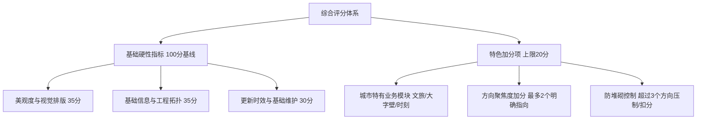

# 🏅 CGo OpenMap 线路图质量评定规范与治理方案 (Quality Standards & Governance Specification)

> **版本**：v0.1 (2026-10)  
> **适用范围**：CGo OpenMap 全网已收录城市、新申请准入城市、Drunk 导出工程及日常版本迭代审查。  
> **制定宗旨**：建立兼具**视觉艺术美感**、**工程拓扑严谨度**、**空间利用效率**与**信息特色深度**的量化评价标准，确保各城市轨道交通交互线路图具备统一的高品质查阅体验，为城市主理人维护、社区贡献评审及下架流转治理提供客观依据。

---

## 一、 质量评价体系总览与评分模型

本规范采用**「基线扣分制（硬性基石）+ 特色加分制（城市创新）+ 方向聚焦度控制」**的综合评价架构（基准总分 100 分，上限 120 分）：



### 1. 评分机制核心设计原则
1. **`core/` 核心功能与基础数据：严格实行「基线扣分制」**：
   - 涉及核心引擎（`core/`）运行与全站交互的硬性基础数据（如站间距 `distances`、物理/地理坐标、站点 ID 闭合性、注册表 `city/data.js` 关键元数据），先赋予满分基准，**缺少一项或格式违规即按项严格扣分**。
2. **`city/` 城市专属扩展目录：实行「特色加分制」**：
   - 各城市目录（`city/{city_id}/`）根据本地文脉与运营特征实现的特色功能（如文化旅游导览、名胜地标、车站大字壁书法艺术、建设历史档案等），按实际质感与体验给予加分奖励。
3. **方向聚焦度与防冗余堆砌原则（Anti-Clutter Principle）**：
   - 线路图必须具有明确清晰的定位指向（旅客服务导向 vs 工程规划导向）；
   - **聚焦 1~2 个方向且做深做透者高额加分**；
   - **严禁盲目贪多堆砌**：方向超过 3 个、多而杂乱导致信息喧宾夺主者，严格限制加分，甚至扣减排版呼吸分。
4. **【核心底线】城市特定功能必须 100% 形成业务闭环（Feature Closed-Loop Principle）**：
   - 鼓励各城市因地制宜创新定制，**功能多或少皆受鼓励**；
   - 但无论功能数量多少，上线与提交 PR 的基础铁律是：**凡是提供的功能必须完全形成业务闭环**；
   - 功能少但全部形成闭环，社区强烈支持；功能多且完全形成闭环，为最佳标杆；
   - **严禁盲目铺量半成品**：若未控制好上线功能数量，出现未闭环、使用中报错或交互死锁的半成品功能，不仅不予加分，还将严肃扣分甚至阻断合并。
5. **【最高红线】全网自检零污染铁律（Zero Contamination to Global Selfcheck）**：
   - `node editor/tests/selfcheck.js` 覆盖全网所有收录城市；
   - 任何单城的 PR 提交必须 100% 保证自检零错误通过，**绝不允许带病合并进入 main 分支从而影响其他城市与公共工具链**。

### 2. 客观中立评审准则与历史教训沉淀（第三次评分修正法案）

在项目治理历史上，城市质量评分曾经历三次典型演进，最终确立了**“客观中立、平衡工程底线与实际用户体验”**的终审评估铁律。**后续所有新收录城市、版本迭代及存量城市的评审，必须 100% 严格基于第三次评分所确立的标准执行，严禁重蹈覆辙**：

```
┌────────────────────────────────────────────────────────────────────────┐
│                   全网城市质量评审的三次历史演进与定案                     │
├────────────────────────────────────────────────────────────────────────┤
│ ❌ 第一次评分（唯文件论 / 虚高人情分）:                                  │
│    • 只要文件存在、表面跑通就盲目给 95~110+ S级高分；                     │
│    • 甚至连早已被官方下架的合肥，都被荒谬地评为 84 分 A 级。              │
│    • 严重教训：缺乏硬核事实审查，人情分泛滥，丧失专业公信力。            │
├────────────────────────────────────────────────────────────────────────┤
│ ❌ 第二次评分（教条主义 / 钟摆极端苛刻）:                                │
│    • 被批评后陷入极端教条，用放大镜死抠代码机械指标；                     │
│    • 将香港、上海对齐官方权威图的高精度微折线死板斥为“碎步”，将深圳待补    │
│      站距无限上纲上线，断崖式将香港(76)、深圳(70)砍成 B 级甚至及格边缘； │
│    • 将石家庄一棒子打死扣到 46 分（比合肥还低）。                         │
│    • 严重教训：脱离实际可用性与用户价值，严重失偏，挫伤社区建设积极性。   │
├────────────────────────────────────────────────────────────────────────┤
│ ⚖️ 第三次评分定案（客观中立 / 平衡工程底线与实际可用性）[唯一基准真源]:    │
│    • 严格区分「正常迭代待补全」与「违背底线的严重违规事故」；             │
│    • 尊重美学多样性：既肯定北京严密正交，也尊重上海香港还原官方图经典美感； │
│    • 以用户核心体验与业务闭环为指引，实现全网公平、客观、令人信服的定案。 │
└────────────────────────────────────────────────────────────────────────┘
```

#### ⚖️ 客观中立评估的核心界限原则：
1. **严格区分「违背底线的严重违规事故」 vs 「正常迭代中的待完善项」**：
   - 🔴 **严重违规事故（一票否决 / 顶格扣分 / 阻断合并或触发下架）**：
     - **严禁人为机械伪造数据**：如石家庄案例中，将 1/2/3 号线全线站间距机械硬编码为 `600` 米、耗时统一硬编码为 `2` 分钟，导致行程规划、乘车计费与时间预估完全失真，严重违背开源求实底线；
     - **排版严重压线遮挡**：如合肥案例中，站名文字直接横贯或骑跨在轨道线条上，破坏基本可读性；
     - **全局自检报红阻断**：单城代码出现语法错误或拓扑损坏导致全局 `editor/tests/selfcheck.js` 报错中断，污染全网工具链；
     - **脱线孤立散点**：大量站点脱离任何线路走向孤立悬空（如石家庄 11 处孤立散点）。
   - 🟢 **正常迭代中的待完善项（包容迭代，合理扣除小分，绝不断崖暴扣或一棒子打死）**：
     - 官方尚未公布精确站距时使用 `"??"` 占位闭合或暂留空（如深圳、香港部分线路），属于版本迭代过程，不属于伪造造假；
     - 未做深度 offset 微调（使用默认 8 方向锚点摆放）但文字并未压线遮挡，仅扣除少量排版体验微距分（1~2 分），绝不可扣除基础工程大分；
     - 暂缺拼音检索库 `staname.csv`，扣除对应检索分（2~3 分），不可全盘否定其工程质量与可用性；
     - 忠实还原官方权威矢量线网图的高精度连续几何形态，尊重其权威性与视觉自洽，严禁教条地一刀切斥为“碎步”。
2. **充分肯定为用户创造核心价值的创新与体验**：
   - 港铁实时到站倒计时、深港双城无缝边缘拖动联动、盛京方城文脉与书法大字壁、呼和浩特蒙汉双语特色等，只要实打实提升用户查阅体验且业务闭环，必须给予充分的特色加分。

---

## 二、 维度一：美观度与视觉排版标准（基准 35 分）

优秀的交通图不仅是数据载体，更是城市视觉工程的艺术品。

> 💡 **核心美学基本原则（设计自由度与审美底线）**：  
> **「你可以不用已有的既定标准，但你自己的标准必须美观！」**  
> CGo OpenMap 鼓励主理人探索符合本城地理特征的排版风格（不强制完全照搬北京的 45° 模式或已有城市的走线范式），但无论选择何种线条形态，**自创的标准必须具备极高的自洽性、几何协调感与严谨的专业美感**。严禁以“个性化自由发挥”为借口，产出粗糙随意、拼接失调、毫无秩序感的劣质走线。

### 1.1 拓扑正交性与几何规整度（8 分）
- **【红线】统一斜线角度体系（严禁多段短直线拼接拟合曲线）（3分）**：
  - **角度统一性**：全网斜线倾角必须体系化统一步调。例如北京等线网严格遵循标准 45° 正交系统；即便部分城市因地理特殊性自定义特定倾角（如沈阳等），该城市全网同一方向的斜线也必须严格统一步调，杜绝同一张图内斜率杂乱无章；
  - **严禁直线碎步拼接伪模拟曲线**：**严禁将多段短直线碎步拼接以试图制造“近似曲线”的伪弧线效果**！这种做法严重违背交通图拓扑美学，在正交与准正交制图规范中属于完全不合格的残次画法；
  - **标准倒角实现平滑过渡**：任何方向变换与拐角必须且只能由折点处的几何倒角圆弧（由引擎 `core/path-geometry.js` 统一倒角半径，直角推荐 `18px`，斜角推荐 `8px`）规范渲染，杜绝折点抖动与多边形碎拼。
- **【强制】正交网格吸附与折角倒角规范（3分）**：
  - 线路走向必须严格吸附于 0°/45°/90° 正交网格，严禁出现未经吸附的 3°~10° 细微手滑歪斜或锯齿状微小偏移；
  - 密集换乘区或极短折线段必须启用 `useStrictRounding: true` 或指定局部圆角 `r`，杜绝圆角过度重叠造成的破角与折线畸变。
- **【强制】平行共线段间距匀称（2分）**：
  - 多条线路平行穿行或共线区段，线间距（Margin）必须恒定，弯道转弯处必须呈规整同心圆弧，严禁忽宽忽窄或交叉重叠穿刺。

### 1.2 文字避让与排版呼吸感（8 分）
- **【红线】严禁站名文字压线与重叠（零压线放置准则）（3分）**：
  - **严禁压线放置**：站名文字（中文与英文）严禁直接骑跨、横贯或压在轨道线上放置，站名必须位于轨道线条外部净空区域；
  - **图元与标签零遮挡**：站名标签严禁遮挡换乘胶囊、换乘图元或相邻站名，相邻站点的文字标签必须保持清晰的安全间距；
  - 凡是出现站名文字直接压在轨道线上的，属于严重排版事故，一票否决。
- **【强制】对齐锚点（Align）合理性（3分）**：
  - 正确使用 8 方向锚点（`top`、`bottom`、`left`、`right`、`top-left`、`top-right`、`bottom-left`、`bottom-right`）；
  - 同一走向的连续站点应保持文字锚点逻辑一致性（如线路西侧一律向左对齐），避免左右毫无规则地反复蛇形跳变。
- **【体验】微距偏移（Offset）与长站名排版（2分）**：
  - 站名文字与站点圆点/胶囊保持 `4~8px` 呼吸空隙（通过 `offset: { x, y }` 精准调校），避免文字悬空过远导致归属混乱；
  - 超长站名（超过 6 个汉字或 20 个英文字符）合理配置换行或 `textScale`，保持全图字号节奏均衡。

### 1.3 空间利用率、排版紧凑度与全局缩放可读性（8 分）
- **【核心】严禁大面积无效空白与松散拉跨（3分）**：
  - 未经严谨推敲的线路图往往站间距盲目拉得极大，造成全图存在大量空洞空白、结构松散松垮；
  - 优秀的交通图必须**充分、合理地运用图面空间与空隙，不浪费画布每一寸视口**。以**北京线网**为行业标杆，经过极其严谨的拓扑工程设计，主城区与外围每一个空隙都被合理穿插与利用，全网紧凑充实、密度均衡，绝无突兀的大片荒漠。
- **【关键】全图概览缩放（Zoom-out）文字可读性（3分）**：
  - **检验空间规划的核心试金石**：当用户将线路图缩小到全景视图（以看清全网概貌）时，关键换乘站与主要站名文字**依然必须能够清晰辨认**；
  - 若因空间排版松散、空白巨大，导致全图被强制极度缩小，使文字缩成无法阅读的微弱噪点，属于排版空间规划不达标。
- **【节奏】全图重心平衡与疏密节奏（2分）**：
  - 核心城区密集换乘区的适度紧凑，与郊区延伸线、市域线的舒展延伸保持自然的比例过渡，画布四周边距（Padding）匀称，全图视觉重心沉稳扎实。

### 1.4 图元规范、色彩权威性与官方基准（6 分）
- **【准入门槛】基准底线：必须达到或超越官方线路图标准（2分）**：
  - CGo OpenMap 的成果底线是**至少达到各城市轨道交通官方正式发布的权威线网图专业美学标准，或者更优**；
  - 若在几何规整度、文字避让、色彩还原或排版专业度上明显劣于官方线网图，属于不合格成果，拒绝收录或限期整改。
- **【标准】标准站点图元与走向（2分）**：
  - 严格使用项目标准：`dot`（普通地下/高架站）、`tsf`（换乘枢纽）、`rdot`（国铁火车站/枢纽）、`no`（暂缓开通/在建未通车站），严禁滥用类型；
  - 国铁与城际铁路若跨越全城且无连续地铁走向，须声明 `isPointOnly: true`，禁止按序号直连拉出横穿全图的飞线。
- **【色彩】色彩权威性与无障碍对比（2分）**：
  - 线路标志色必须 100% 对应城市官方最新发布的标准色卡 Hex 值；
  - 色彩饱和度与明度适中，白底与黑底下均清晰可读，符合 Web 无障碍对比度（WCAG AA 3:1+）要求；
  - 邻近线路色彩必须具有显著辨识度，严禁两条色值极其相近的线路在无换乘标识的情况下平行动行引发混淆。

### 1.5 双主题（亮/暗模式）适配（5 分）
- **【强制】全局深浅色自动适配（3分）**：
  - 站点边框、站名文字、底图水系、换乘外圈在亮色模式（白天）与暗色模式（夜间）下均自然切换，无反色异常；
  - 严禁在车站或线路数据中硬编码固定文字背景色导致暗色模式下发白刺眼。
- **【体验】高分辨率 Retina 屏清晰度（2分）**：
  - 矢量 SVG 渲染精准无发虚，移动端缩放至 2.5x 以上时文字无撕裂或毛刺。

---

## 三、 维度二：基础信息完整度与工程规范（基准 35 分，基线扣分制）

基础数据是交互式地图的灵魂，`core/` 引擎依赖的底层数据必须严谨无误。

### 2.1 站名规范与多语言检索库（10 分）
- **【准确】中文站名 100% 准确（4分）**：与官方最新名牌完全一致，校对生僻字、多音字及副站名括号规范，发现错字/别字扣分。
- **【国际化】英文/拼音规范化（3分）**：符合官方译名体系（缩写如 `Railway Station`、`Rd` 规范），拼音分词正确，发现机翻/拼写错误扣分。
- **【检索】拼音与别名检索库（3分）**：提供城市拼音索引（`staname.csv`），支持首字母拼音与历史更名检索。缺少检索库扣 2 分。

### 2.2 核心工程拓扑与硬性数据完整性（10 分）
- **【硬性】站间距数据（`distances`）结构与状态规范（4分）**：
  - **国铁散点豁免原则**：声明 `isPointOnly: true` 的线路（如全城离散国铁火车站落点 `Rwy`、`HSR_PT` 等）**不构成连续地铁走向，100% 豁免站距检查**，严禁将其误算为缺失站距扣分。
  - **严格区分「站距待补全」与「缺失站距/失配」两种状态**：
    - 🟢 **状态 A：站距待补全（已占位合规，允许合并）**：
      - 针对新开通线路或官方尚未公开具体里程的区间，允许在 `distances` 数组中填充 `"??"` 占位字符串（如 `distances: ["??", "??", ...]`）；
      - 只要数组长度严格满足几何闭合公式（单线 `length === stationIds.length - 1`，环线 `length === stationIds.length`），**即视为满足引擎结构完整性要求，自检能够通过，不扣除核心工程分，不阻断 PR 合并**（可在后续版本逐步核准填补真实米数）。
    - 🔴 **状态 B：缺失站距/长度失配（严重工程事故，阻断合并）**：
      - 常规连续地铁线路完全漏写 `distances` 属性；
      - 或 `distances` 数组长度与车站数严重不匹配（导致前台点击里程算路抛出 NaN 甚至崩溃）；
      - **扣分规则**：常规线路完全漏写 `distances` 直接扣 4 分；长度失配每条线路扣 1 分；自检报错者直接阻断 PR 合并。
    - 🚫 **状态 C：人为机械伪造站距与运行耗时（诚信与数据真实性红线，一票否决/严惩）**：
      - **严禁为了应付自检而机械填入虚假数据**（如石家庄曾将全线所有区间的站间距机械硬编码为 `600` 米、区间耗时统一填 `2` 分钟）；
      - 伪造假数据会导致前台乘车耗时预估、最短路径算法与按里程计价系统彻底失真，严重违背开源交通地图的求实底线；
      - **整改与扣分规则**：发现人为大面积机械伪造站距或耗时者，**直接扣除基础分 5 分**，下发限期整改单，若逾期未清除假数据直接下架隐藏。若暂无官方精确数据，必须且只能按状态 A 规范填充 `"??"` 声明待核，严禁伪造数字！
- **【拓扑】运行拓扑与站点 ID 规范（3分）**：
  - 车站 ID 全局唯一且闭合；环线声明 `isLoop: true`；分支声明 `hasbranch: true` 与 `way1/way2`。出现断链或悬空未定义 ID 扣分。
- **【地理】中心点与视口尺寸坐标（3分）**：
  - 城市配置中的 `center: { x, y }`、`defaultScale`、`mapSize` 必须真实有效，确保初次打开精准居中。未配置或坐标偏移扣分。

### 2.3 换乘体系与大交通枢纽（10 分）
- **【枢纽】物理换乘准确性（4分）**：共站换乘共用坐标与 ID，图元正确融合，无遗漏换乘节点。
- **【虚拟换乘】出站连通映射（3分）**：存在虚拟出站换乘的城市，需提供 `data_virtual_transfers.js` 标明换乘距离与时效。
- **【交通枢纽】大交通联动（3分）**：机场、高铁火车站等交通枢纽属性完整，图标调用标准 CGoUI 组件。

### 2.4 图例与索引体系（5 分）
- **【清晰】图例分组（3分）**：`data_legend.js` 分类清晰科学，支持按制式筛选折叠。
- **【徽标】线路矢量徽标（2分）**：匹配标准 `assets/svg/` 矢量模板或动态注入色谱。

---

## 四、 维度三：更新时效与基础维护（基准 30 分，基线扣分制）

### 3.1 时效性与运营变动响应（10 分）
- **【时效】新线开通响应（5分）**：
  - ⚡ 官方通告发布或开通后 **72 小时内** 提交更新 PR（5分）；
  - ⚠️ **15 天内** 提交更新 PR（3分）；
  - ❌ 超过 **30 天** 无人响应，直接扣 5 分并触发质量预警。
- **【在建】在建走向规划合理性（5分）**：
  - 在建与规划虚线（`data_notopen.js`）走向与发改委批复规划一致，排版美观，无凭空捏造。

### 3.2 城市注册表与工程文档完整性（10 分，硬性检查）
> 🚨 **重点治理问题**：坚决杜绝“城市已经上线、但主理人信息与配套文档甚至都没填写”的失范现象！
- **【注册表】`city/data.js` 关键元数据（5分）**：
  - 必须完整填写：城市名称、主题色、`maintainers` 主理人信息（姓名/GitHub链接）、官方网址 `officialMapUrl`、`searchCity`；
  - **扣分规则**：主理人 `maintainers` 缺失或留空直接扣 3 分；缺少官网链接或检索城市扣 1 分。
- **【文档】全站说明与名录登记（3分）**：
  - `README.md`、`README_EN.md` 与 `readme.html` 中同步登记城市上线信息与主理人署名。未登记或描述脱节扣分。
- **【缓存】Service Worker 同步（2分）**：
  - PR 必须同步递增 `sw.js` 缓存版本并在 `ASSETS_TO_CACHE` 登记新资源，未更新扣 2 分。

### 3.3 代码规范与纯前端基石（10 分）
- **【纯前端铁律】（5分）**：100% 纯原生 JavaScript/SVG/CSS，严禁引入 Node.js 后端/PM2 守护/React/Vue 框架及打包工具。
- **【自动化自检与全网零污染红线】（3分，绝对合并门禁）**：
  - 必须 100% 干净通过 `node drunk/tools/selfcheck.js` 全量回归自检，控制台零报错、零失败；
  - 🚨 **防污染连带铁律**：`selfcheck.js` 是一套跨 15 座城市的全局自动化检验套件。若某个城市代码存在隐蔽语法缺陷或拓扑脏数据导致自检失败，**一旦合入 main 分支，全网所有其他城市的主理人与 CI 流水线均会同时报警报错、陷入瘫痪**！
  - 凡是本地运行自检失败的 PR，**严禁批准合并入 main 分支，属于一票否决项**。
- **【UI 图标规范】（2分）**：界面与模块严禁滥用 Emoji，强制使用 `<cgo-icon>` 矢量组件。

---

## 五、 维度四：特色功能与方向聚焦度加分项（上限 20 分）

鼓励各城市基于 `city/{city_id}/modules/` 开展个性化创新，但加分必须建立在**“方向明确、质感优良、杜绝臃肿”**的前提下。

### 5.1 方向聚焦度判定（加分放大器与防冗余机制）

每个优秀的城市线路图应当具有**鲜明的核心受众与业务定位**：

| 定位方向类型 | 核心服务目标 | 典型特色模块支撑 |
| :--- | :--- | :--- |
| **方向 A：旅客出行与运营导向** | 深度服务乘车旅客日常出行与高效换乘 | • 首末班车双向时刻表 (`data_timetable.js`)<br>• 同台/通道换乘步行动线与耗时指引<br>• 岛侧式站台结构示意图 (`stacard/`)<br>• 地面公交微循环与 P+R 驻车接驳 |
| **方向 B：城市文脉与视觉艺术导向** | 展现城市深厚文旅底蕴与车站视觉艺术 | • 车站名胜古迹与红色文旅地标导览 (如北京)<br>• **车站大字壁/书法艺术题字图** (如沈阳大字壁)<br>• 车站公共艺术品、历史主题壁画导览 |
| **方向 C：工程建设与规划历史导向** | 记录城市轨道建设史与前瞻规划演进 | • 详尽的施工工区与在建工期进度指示<br>• 历史曾用站名更替轨迹与工程名溯源<br>• 远景轨道交通线网虚线规划深度呈现 |

#### 🎯 加分与控分规则：
1. **方向明确聚焦（加 3~5 分）**：
   - 城市线路图明确锁定 **1 ~ 2 个主攻方向**，并在该方向上做到数据详实、界面精致、交互流畅，给予全额特色加分。
2. **贪多杂乱堆砌惩戒（控分 / 扣分）**：
   - 若方向超过 **3 个**（又想做文旅、又塞满工程历史、又堆砌施工进度、又塞大量杂项运营），导致图面与面板信息极度臃肿庞杂，严重干扰乘客针对性查询：
     - **取消方向聚焦加分**；
     - 特色模块加分总额**强制腰斩（封顶不超过 5 分）**；
     - 若严重破坏图面排版呼吸感，**追加倒扣 3 分排版呼吸分**。

### 5.2 具体特色项目加分细则（单项累计，上限 15 分）
1. **车站大字壁与视觉艺术展示（+3~5 分）**：
   - 将车站大字壁、名家题字书法图片高质量融入车站面板（如沈阳站名大字碑），排版优雅、适配亮暗模式。
2. **高精度首末班车时刻系统（+3~5 分）**：
   - 具备完整双向、平日/周末运营时刻表数据，覆盖全网主要站点。
3. **城市文化旅游特色深度模块（+2~4 分）**：
   - 深度挖掘周边 5A/4A 景区、重点文博地标，图文排版考究、无低俗商业推广。
4. **车站立体空间与站台结构图（+2~4 分）**：
   - 提供岛式/侧式站台、电梯出入口及最佳换乘车厢门指引。
5. **在建工程与历史站名溯源系统（+2~3 分）**：
   - 详尽记录建设历史更迭与工程演变，考据严密、信源权威。

### 5.3 城市特有功能准入标准：完整业务闭环原则（Feature Closed-Loop Standard）

为特定城市开发专属定制功能，是一件极富价值、受到官方团队大力提倡的事情。关于特色功能的开发规模、成熟度与上线门槛，确立以下核心准则：

1. **功能规模自由：数量多或少皆受支持，唯「业务闭环」为硬性铁律**：
   - 社区充分尊重主理人的开发精力，**功能数量多少完全由开发者自由掌控**；
   - 无论是只做了一个小巧精致的专属功能，还是构建了丰富多元的复杂系统，只要每一个上线的功能都做到了**逻辑自洽、交互完整、体验扎实**，都是社区所认可的高质量工作。
2. **闭环状态判定标准与对应奖惩机制**：
   - 🌟 **类型一：功能多且完全形成闭环（最高标杆，顶格加分）**：
     - 同时开发了文旅导览、站台图、时刻表等多项功能，且每项功能均有完备的数据支撑、优雅的 UI 交互、健全的错误兜底机制；
     - 评定：给予特色加分项顶格满分（上限 20 分），作为 S 级示范城市推荐。
   - 🟢 **类型二：功能少但全部形成闭环（成熟合格，全力支持）**：
     - 精力有限时克制上线功能数量，仅推出 1 个或少量子模块（例如仅专注做好了全网大字壁题字卡片），但该模块从加载渲染、缩放交互、亮暗模式到关闭退出 100% 形成闭环，无任何断头逻辑与异常报错；
     - 评定：充分享受该单项的特色加分（+3~5分），安全稳定，完全达到合并上线标准。
   - 🔴 **类型三：盲目铺量、未形成闭环的半成品堆砌（严重不可取，严厉减分与阻断）**：
     - 未能有效控制上线功能的节奏与范围，部分功能完成尚可，但同时草率提交了若干未闭环的半成品模块；
     - **典型未闭环表现**：
       - 点击特色按钮抛出控制台未捕获异常（Uncaught Error）；
       - 数据缺失时界面留白瘫痪、缺失空状态兜底（Fallback）；
       - 弹窗或侧边栏打开后无法正常关闭、陷入交互死锁；
       - 特色逻辑污染主线网交互或导致底层 `core/` 引擎偶发报错；
     - **惩戒规则**：
       - 凡是包含严重未闭环半成品功能的，**一律取消对应模块的加分资格**；
       - 视未闭环缺陷的恶劣程度，**每个未闭环半成品额外扣除 2 ~ 5 分**；
       - 若半成品模块引发运行时报错或破坏主线网核心查阅体验，**直接阻断 PR 合并（驳回并要求剥离半成品后再提）**。

---

## 六、 综合评级划分与治理机制

综合得分 = **基础分（100分基线 - 扣分项） + 特色加分项（上限 20分）**：

### 1. 全网统一质量等级矩阵（Unified Quality Grade Matrix）

| 评定等级 | 综合得分区间 | 核心品质定义 | 新城市准入 / PR 审核门槛 | 已上线存量城市运维状态 |
| :---: | :---: | :--- | :--- | :--- |
| 🌟 **S 级** | **95 ~ 120 分** | **标杆示范城市** | 官方重点推荐，树立全网设计典范 | 首页高光推荐，主理人享金色徽标与完全自治权 |
| 🟢 **A 级** | **80 ~ 94 分** | **优质成熟城市** | 表现卓越，免繁琐复审直接合入 | 首页稳定展示，支持持续迭代特色子模块 |
| 🟡 **B 级** | **70 ~ 79 分** | **合格可用城市** | **【准入合并正式上线底线】**<br>自检 100% 零错误方可合并 | 正常公开展示与收录，限期充实冲刺 A 级 |
| 🟠 **C 级** | **60 ~ 69 分** | **观察整改城市** | **【发起 PR 门槛，严禁直接合】**<br>须在 PR 评论区协作整改打磨 | **预警观察状态**：下发 14 天限期整改通知 |
| 🔴 **D 级** | **< 60 分** | **不合格/下架城市** | **【严禁发起 PR】**<br>直接关闭驳回，严防污染仓库 | **执行门户卡片隐藏下架**，席位进入保全流转期 |

---

### 2. 新城市准入与 PR 合并三阶段全流程机制

为保障开源成果的高品质交付，同时为社区贡献者留出协作共建空间，新城市收录与重大版本合并严格执行**「三阶段准入门槛」**：

1. **阶段一：发起 PR 准入门槛（自查达到 C 级，60 ~ 69 分）**：
   - 贡献者在提交代码前，必须对照本规范进行自查，评分达到 **C 级（≥ 60 分）** 且核心工程自检通过，方可发起 Pull Request；
   - ❌ **低于 60 分（D 级）严禁发起 PR**：凡是存在严重站名文字压线、弯道短直线碎步拼接、全局自检报错或弃填主理人信息的，一律不得提交，发起后会被直接关闭并要求先自行修复。
2. **阶段二：社区协作与评审整改（C 级成果不予直接合并）**：
   - 刚发起 PR 的 C 级成果**原则上不会被直接批准合并（Do Not Merge as C-grade）**；
   - 贡献者需在 GitHub PR 评论区中与核心团队及社区合作者一同展开针对性评审，根据反馈共同进行走向优化、避让调校与站距核对。
3. **阶段三：正式合并上线门槛（整改达到 B 级 ≥ 70分 + 全网自检 100% 零错误）**：
   - 只有经过整改打磨，综合得分**稳定达到 B 级（≥ 70 分）及以上水平**；
   - **绝对红线前置条件**：`node drunk/tools/selfcheck.js` 全网跨城自动化回归自检必须 100% 零错误通过（严防单城错误带入 main 导致全网其他城市开发者受损）；
   - 满足上述两项后，**才被允许在 GitHub 上正式合并（Merge）并上线展示**！

---

### 3. 已收录城市的日常运维与治理规则

- **S 级 / A 级（标杆与优质成熟，≥ 80分）**：稳定运行在首页门户，主理人享有完全版本自治权，重点推荐展示。
- **B 级（合格可用，70 ~ 79分）**：达到合并上线底线，正常展示并鼓励主理人持续充实特色模块冲刺 A 级。
- **C 级（预警观察，60 ~ 69分）**：已上线城市若因长期维护脱节、局部出现排版缺陷、出现未闭环半成品报错或站距失配掉入 C 级，下发限期 14 天整改通知。
- **D 级（下架归档，< 60分）**：综合得分跌破 60 分（如长期弃管、存在压线或拓扑断裂），**执行首页门户卡片下架隐藏**，主理人席位进入保全流转期。

### 4. 典型治理案例深度剖析（第三次评分典型判例）

为使评审标准更加具象化，避免“人情分虚高”或“机械教条苛刻”，确立以下三大典型治理案例作为裁决参照：

#### 案例一：合肥线网（`city/hefei/`）—— 🔴 48 分，D 级下架维护典型
- **缺陷 1：站名文字直接横贯压线** —— 大量车站站名直接横跨在轨道线条中央，完全遮挡走向，严重违反零压线红线；
- **缺陷 2：多段短直线碎步拼接伪模拟曲线** —— 拐弯弯道处手工用 5~10 段极短细碎折线拼成多边形碎步以试图模拟圆弧，破坏引擎统一倒角渲染；
- **缺陷 3：常规线路 100% 缺失站间距** —— 1~8 号线全部线路完全未提供 `distances` 属性；
- **处置方案**：综合得分 48 分（D 级），**执行门户首页卡片下架隐藏**（保留底层路由 `?city=hefei` 与源码），主理人席位进入保全流转期，等待社区提交 A 级重构方案。

#### 案例二：石家庄线网（`city/shijiazhuang/`）—— 🟠 66 分，C 级限期整改典型
- **缺陷 1：全网人为机械伪造站距与耗时（严重造假事故）** —— 1/2/3 号线全线站间距被一律机械硬编码为 `600`（米），区间耗时统一填 `2`（分钟），导致前台乘车耗时与计价完全失真，严重违背开源求实原则；
- **缺陷 2：脱线孤立散点堆积** —— 包含 11 处未依附于任何运营线路的孤立车站与非标景点（如 `terminus`、`via`、`scenery`、`railcity` 等非标图元滥用）；
- **缺陷 3：自动化测试曾导致报红阻断** —— 曾因站距数组长度失配直接导致全局 `editor/tests/selfcheck.js` 中断报错；
- **处置方案**：综合得分 66 分（C 级），**列为重点预警观察城市，下发整改清单限期 14 天整改**：必须彻底清除伪造的 600m/2min 数据，收敛非标图元为标准 `dot/tsf/rdot/no`，清除脱线孤立点，达标后方可解除预警。

#### 案例三：香港与深圳线网（`hongkong` / `shenzhen`）—— ⚖️ 客观中立评价、反对教条降级典型
- **背景**：在第二次过度苛刻评分中，香港因部分对齐官方线网图的几何形态被死板斥为“碎步”，深圳因暂缺官方站距被全盘否定，导致两城被极端打到 76 分与 70 分（B 级及格边缘）。
- **客观中立纠偏**：
  - **深圳（94 分，🟢 A 级）**：拥有 359 站超大现代线网，深港陆路口岸无缝衔接与通关提示极为顺畅，图面规整度与实际可用性极高；官方未公布站间距属于**正常迭代中的待补全项**，不属于恶意伪造假数据，不可断崖式降为 B 级；
  - **香港（106 分，🌟 S 级）**：首创深港双城边缘拖动无缝联动、同台换乘指引极具实用价值、双语排版国际化严谨，忠实还原官方港铁矢量图经典美学，用户体验处于全网第一梯队，稳居 S 级标杆；
- **经验沉淀**：**评审必须深入实际使用场景，坚决反对脱离实际可用性的教条苛刻！**

---

## 七、 全网城市质量梯队分布基准（基于第三次客观评分 Ground Truth）

为确保后续所有新旧城市的评估有一致的对照真源（Ground Truth），全网 15 座城市基于第三次客观评分的权威基准分布如下：

| 梯队等级 | 城市 ID | 城市名称 | 美观排版 (35) | 基础工程 (35) | 维护时效 (30) | 特色加分 (≤20) | 最终总分 | 客观定位与核心价值 |
| :---: | :--- | :--- | :---: | :---: | :---: | :---: | :---: | :--- |
| 🌟 **S 级**<br>(≥95分) | `beijing` | **北京** | 35 | 35 | 30 | +15 | **115 分** | **全能顶级标杆**：45°/90° 正交严密，全景缩放文字清晰，文旅地标与时刻表完备闭环 |
| 🌟 **S 级** | `shenyang` | **沈阳** | 34 | 35 | 30 | +10 | **109 分** | **文脉艺术标杆**：斜线倾角统一自洽，首创车站大字壁名家书法题字卡，盛京方城文化典范 |
| 🌟 **S 级** | `shanghai` | **上海** | 34 | 35 | 30 | +8 | **107 分** | **超大规模工程标杆**：414 站 21 线对齐官方矢量标准，站间距 100% 真实，自检 0 错误 0 告警 |
| 🌟 **S 级** | `hongkong` | **香港** | 33 | 31 | 30 | +12 | **106 分** | **跨城联动与运营标杆**：首创深港双城平滑拖动联动，同台换乘体系完备，双语国际化典范 |
| 🌟 **S 级** | `qingdao` | **青岛** | 34 | 34 | 30 | +7 | **105 分** | **滨海地理与溯源标杆**：纯正交无歪斜，胶州湾海域底图优雅，在建工期与更名历史档案详实 |
| 🌟 **S 级** | `sydney` | **悉尼** | 33 | 33 | 30 | +5 | **101 分** | **国际化干线标杆**：T1~T9 干线与 M1 地铁融合，双语排版优雅，CGoUI 矢量组件规范 |
| 🟢 **A 级**<br>(80~94分) | `shenzhen` | **深圳** | 32 | 29 | 28 | +5 | **94 分** | **成熟大网枢纽**：359 站大网流畅、深港口岸无缝衔接；站间距与拼音库待进一步充实 |
| 🟢 **A 级** | `dalian` | **大连** | 33 | 32 | 26 | +2 | **93 分** | **滨海与历史有轨典范**：201/202 百年有轨电车收录，站距真实闭合，走向舒展自然 |
| 🟢 **A 级** | `changchun` | **长春** | 32 | 32 | 27 | +2 | **93 分** | **多轨制式融合典范**：地铁与历史有轨电车和谐统一，开通沿革时间线完备 |
| 🟢 **A 级** | `fuzhou` | **福州** | 32 | 34 | 26 | +1 | **93 分** | **海湾与交通枢纽典范**：自检 0 告警，6 条线路站间距 100% 真实，海陆空接驳完备 |
| 🟢 **A 级** | `lanzhou` | **兰州** | 31 | 34 | 24 | +1 | **90 分** | **沿河狭长线网典范**：黄河水系与票价指南完备，中川城际机场联动；规划虚线较丰富 |
| 🟢 **A 级** | `hohhot` | **呼和浩特**| 31 | 31 | 24 | +3 | **89 分** | **双语文化典范**：全网唯一蒙汉双语特色站名，十字走向工整规整，站距真实闭合 |
| 🟢 **A 级** | `harbin` | **哈尔滨** | 31 | 31 | 24 | +1 | **87 分** | **江北环线与文脉典范**：松花江水系，3 号线成环闭合，建设沿革时间线完整 |
| 🟠 **C 级**<br>(60~69分) | `shijiazhuang`| **石家庄** | 24 | 22 | 20 | +0 | **66 分** | **限期整改观察城市**：全网机械伪造 600m 假站距与 2min 假耗时，11 处脱线孤立散点 |
| 🔴 **D 级**<br>(<60分) | `hefei` | **合肥** | 14 | 18 | 16 | +0 | **48 分** | **官方下架维护城市**：站名横贯压线、碎步拟合伪曲线、全网完全缺失站间距 |

---

## 八、 常见排版与拓扑缺陷自查及重构指南

在线路图制作与日常维护中，容易出现的几类共性排版与工程缺陷如下，供各城市主理人及贡献者在自查与重构时对照参考：

1. **缺陷一：站名文字直接压线**
   - **现象**：文字标签直接横跨或覆盖在轨道实线上，严重破坏图面清晰度。
   - **改进**：使用 `align`（8方向锚点）与 `offset: { x, y }` 将文字完全移出轨道净空区，保持 `4~8px` 安全呼吸间距。
2. **缺陷二：使用多段短直线拼接伪模拟曲线**
   - **现象**：在转弯处手工用 5~10 段极短的小折线拼成多边形碎步，试图手绘出弧线效果，导致折点生硬、渲染不协调。
   - **改进**：仅保留关键的 90° 或 45° 主干折点，将拐弯平滑过渡完全交由引擎共享几何模块（`core/path-geometry.js`）的统一倒角算法处理。
3. **缺陷三：斜线倾角体系不统一**
   - **现象**：同一张图内斜线随意倾斜（如 15°、37°、60° 混杂），缺乏几何系统性。
   - **改进**：建立体系化的正交或准正交角度体系（优先统一为 45° 或城市全网统一的角度），确保同向斜线步调严格一致。
4. **缺陷四：空间规划过于松散与留白过大**
   - **现象**：站间距盲目拉大，全图大面积空洞，导致用户在缩小全景视图（Zoom-out）时文字被缩成极小噪点难以辨识。
   - **改进**：合理穿插布局，压缩无意义的超长空隙，兼顾高密度换乘区与外围延伸线的比例节奏。
5. **缺陷五：站间距（`distances`）数据严重缺失或长度失配**
   - **现象**：常规地铁线路完全漏写 `distances`，或数组长度与站点数不满足校验公式，导致引擎抛错或里程计算异常（注：国铁 `isPointOnly: true` 散点不属此列）。
   - **改进**：若暂缺官方精确里程，先使用 `"??"` 占位填充使数组长度完全闭合（`stationIds.length - 1` 或环线 `length`）；后续结合官方资料核准真实数值。
6. **缺陷六：特色功能未闭环（半成品报错上线）**
   - **现象**：贪多上线未完工的特色按钮、弹窗或功能卡片，点击出现控制台未捕获错误、界面死锁无返回或暗色模式破损，严重破坏用户体验。
   - **改进**：克制上线数量。宁可功能少但 100% 闭环无报错，也绝不上线半成品。若精力不足，应彻底剥离未闭环模块后再提交 PR。
7. **缺陷七：破坏全局自动化回归自检（污染全网测试）**
   - **现象**：单城数据格式错误或代码语法瑕疵，导致全局 `node editor/tests/selfcheck.js` 报错中断，直接连带影响全网其他 14+ 座城市的正常开发与 CI 流程。
   - **改进**：提交 PR 前必须在本地运行并保证 `node editor/tests/selfcheck.js` 100% 零错误通过，严防脏数据污染公共仓库。
8. **缺陷八：人为机械伪造假数据与脱线孤立散点（以石家庄为例）**
   - **现象**：为了应付自检或偷懒，全线站间距机械统一填 `600` 米、耗时统一填 `2` 分钟，且图面上堆积脱离运营线路走向的孤立非标景点散点。
   - **改进**：坚决剔除任何人为伪造数据！若官方尚未公布精确站距，必须使用 `"??"` 占位字符串合规闭合；将景点与拓展地标收敛入专属特色模块（如 `modules/`），严禁在主线网图层滥用非标图元堆砌脱线散点。

---

## 九、 评审打分实操清单 (Checklist)

> ⚖️ **审阅人准则提醒（第三次客观评分铁律）**：  
> 评审打分必须保持**中立客观**：既不可仅凭“文件存在”就泛滥给虚高人情分（坚决核查压线、伪造数据与自检红线）；也绝不可陷入教条主义、脱离实际可用性无限放大微小瑕疵（不可把官方高精度线型死板斥为碎步，不可把待补站距无限上纲上线导致断崖式降级）。

```markdown
### 📋 线路图质量评审打分表 (基于第三次客观评分标准)
城市名称: _____________    评审人: _____________    日期: _____________

【一、美观度与视觉排版 (基准 35分)】
- [ ] 1.1 走向严格符合 0°/45°/90° 正交网格，倒角平滑无碎拼拟合 (尊重官方权威高精度几何) (___/8)
- [ ] 1.2 站名文字 100% 避让零压线，图元无遮挡，8方向锚点合理 (未深度微调但无压线仅扣微距分) (___/8)
- [ ] 1.3 空间利用充分无大片空白，全图缩小概览时文字依然清晰可读 (以北京为标杆) (___/8)
- [ ] 1.4 图元规范 (收敛为dot/tsf/rdot/no)，官方色谱准确，达到或超越官方线路图标准 (___/6)
- [ ] 1.5 深色与浅色双模式完美自适应，高分屏清晰无毛刺 (___/5)

【二、基础信息完整度与工程规范 (基准 35分，基线扣分制)】
- [ ] 2.1 站名中英文规范严谨，无错别字与机翻，配备快速检索索引 (缺少检索库扣2分) (___/10)
- [ ] 2.2 站间距与拓扑闭合 (___/10)
      • 站间距 distances 长度严格匹配 (允许 "??" 占位待补全，国铁散点豁免)
      • 🔴 严禁机械伪造假数据 (如全线统一硬编码600m/2min)，违者直接扣5分并限期整改
      • 拓扑 ID 闭合，无脱线孤立点
- [ ] 2.3 换乘站连通正确，大交通枢纽完备，支持出站虚拟换乘映射 (___/10)
- [ ] 2.4 图例分类清晰科学，线路徽标显示完整 (___/5)

【三、更新时效与基础维护 (基准 30分，基线扣分制)】
- [ ] 3.1 最新开通线路/车站无遗漏，在建线路走向权威可靠 (___/10)
- [ ] 3.2 city/data.js 关键元数据 (含主理人maintainers/官网链接) 填写完整，文档同步 (___/10)
- [ ] 3.3 严格遵循纯前端大前提，控制台零报错，100% 干净通过 editor/tests/selfcheck.js (零污染红线) (___/10)

【四、特色功能与方向聚焦度 (加分项，上限 20分)】
- [ ] 4.1 定位方向聚焦明确 (旅客服务导向 vs 工程规划导向，不超过2个主攻方向) (加 ___/5分)
- [ ] 4.2 车站大字壁书法艺术 / 文旅地标 / 首末班车时刻 / 跨城联动特色模块 (加 ___/15分)
- [ ] 4.3 完整业务闭环考核：特色功能凡提供必须 100% 闭环无报错；若有未闭环半成品扣减 (减 ___分)
- [ ] 4.4 堆砌惩戒：若方向多于3个且内容杂乱冗余，扣除加分或排版分 (减 ___分)

======================================================================
★ 综合最终得分: _____ 分 (基线100分 - 扣分 + 加分)
★ 评定等级: [ ] S级 (≥95)  [ ] A级 (80-94)  [ ] B级 (70-79)  [ ] C级 (60-69)  [ ] D级 (<60)
★ 评审结论: [ ] 准予上线  [ ] 限期整改补充  [ ] 暂缓上线/下架维护
```

---

> 💡 **项目最终解释权说明**：本评定规范旨在保障开源成果的艺术质感与工程健壮性，规范细则由 CGo OpenMap 官方核心团队持续迭代完善并保留最终解释权。
